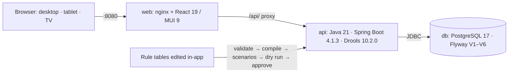

# ShiftCircle build record

**What it is:** a working prototype that schedules 8, 12 and 16-hour shifts at a fictional 24/7 provincial correctional centre. Every change is checked by a Drools rules engine, whose rules non-technical staff edit as decision tables, and approved by a supervisor. Time feeds a simulated payroll export. All data is synthetic. It isn't an official Government of Saskatchewan service. Setup: `README.md` § Setup.

## 1. Architecture

Only the web publishes a port. A published rule version is compiled and swapped in without a redeploy. A change goes: preview → save → `422` with plain reasons → acknowledge a warning, or override an emergency-policy Block with a reason → audit event (ADR-014).

## 2. Key decisions

- No AI at runtime: the rules engine decides, and a supervisor approves (ADR-002, ADR-005).
- Drools decision tables are edited in the app; publishing uses maker/checker, test scenarios and a dry run (ADR-012).
- Coverage is by unit and block, measured hourly in absolute time (the NIGHT block on D is 23:00 D–07:00 D+1). Overtime is the hours over the pay-period threshold (ADR-013, 016, 017).
- Baseline rule set v2 (V6) is seeded PUBLISHED by migration, like v1, without maker/checker and without an audit row; every later version uses maker/checker (docs/04 §6).
- **Deviations confirmed by the project lead on 2026-11-20:** only emergency Blocks can be overridden (ADR-023); lock and export are facility-wide (ADR-022); cross-unit cover (ADR-024). Audit relies on triggers, not grants (ADR-018, prototype only).

## 3. AI-assisted development

**Who did what.** Claude Opus 5.5 did the design and specs (2026-11-19). From 2026-11-20 an OpenRig team of AI agents built and verified it, and the project lead set direction:
- **Builders:** DeepSeek V4.1 Flash (dev-build2 on MiniMax until 05:06Z).
- **Verifiers:** dev-qa and review-r2 on GLM 5.3 until 12:55Z, then GLM 5.3 Flash; review-r1 on GLM 5.3 Flash.
- **Final security review:** review-r3, Claude Sonnet 5.5.
- **Lead:** Claude Sonnet 5.5. **Design, e2e and docs:** Claude Opus 5.5.

**Independence, honestly:** builders and verifiers are different model families, except from about **10:07Z to 11:30Z**. The OpenCode credit ran out, and all five OpenCode seats ran on MiniMax (M3.1 Flash building, M3 verifying). Those rounds (R32–R34) have weaker independence. **The final rounds (R38, R39, R41, R43–R47) were GLM 5.3 Flash**, a lower tier, still independent of the DeepSeek authors.

**How it was verified:** 47 review and QA rounds, three e2e runs and two visual reviews, each recorded with what was checked, found and fixed (`docs/review-rounds.md`; narrative in `docs/ai-dev-log.md`). Fixes were proved by reverting them and watching their test fail.

**What verification caught** that had passed the author's own tests:

| Defect | Caught by | Ref. |
|---|---|---|
| **Remote code execution through a rule edit** (unescaped values in generated Drools source; no approval needed). Fixed in three layers, each enough alone | review-r2 ran a payload | R24, R28 |
| **Concurrent saves passed a Block rule**; now a per-officer lock | review-r2 | R13, R16 |
| **Source missing from git, twice** (web `.gitignore` lines hid Java packages); now a guard script | review-r2, builder | R5, log #25 |
| **Stale wall display looked live and overflowed**; automated checks covered only the live state | visual review | Visual, R27 |
| **Blank page for the auditor** (a `null` the fixtures never had); a **raw 500** whose handler was tested only directly; the payroll lock on the real clock; a test-order bug; a flaky web suite | dev-qa, real-api e2e | R25–R37 |
| **UI test (80 screenshots reviewed):** date a day early, Confirm on a filled shift, stale board after a save, wrong chart axis, a reload lost the session; all fixed | dev-design, dev-qa | R43–R46 |
| **What the GLM passes missed:** an open-shift **double fill** (3 officers filled one need; fixed by a shift-row lock and status re-check, with a conditional update as defence in depth), an **unscoped roster list**, an unlock audit overcount; all re-verified live | review-r3 (Claude) | R40, R42 |

**Suggestions corrected or rejected:** the lead rejected a custom rule catalogue and 16 h shifts as overtime-only (log #5, #13). The builder rejected a catch-all handler that hid `403`s as `500`s, then built it safely (log #69).

## 4. Test cases and verified status

**Final (independent, R46):** api **356** at `f4496c6`; vitest 239; Playwright desktop 86, tablet 85 + 1 skipped, 0 failed. The last api change was reviewed: safe (R47).

| ID | Case | Expected | Result |
|---|---|---|---|
| T2 | 12 h shift, then 8 h after 7 h rest | BLOCK, nothing saved | 422, **no override** (R12, R30) |
| T3 | Exactly 8 h of rest | U-01 PASS, U-02 WARN | 8 h 00 m PASS, 7 h 59 m BLOCK (R4, R7) |
| T7 | U-10 from 4 to 3 nights, no code | Dry run, then warns | Approved and published by another user (R23, R28) |
| T8 | Payroll export, locked period | Equals the golden file | Recomputed independently; byte-identical (R17, R33) |
| T9 | 17 h in a lockdown | Needs a reason ≥ 10 chars | Short refused; audited (R12, R13) |

## 5. Governance and ministry suitability

- **Synthetic data, no secrets:** 100 fictional officers; weak secrets are refused; the history has no `.env` or keys (R30).
- **Safeguards:** emergency overrides need a written reason and are audited; other Blocks can't be overridden; maker/checker; rule input is treated as untrusted.
- **Privacy:** role and unit scope on every endpoint (`404` outside); the wall display shows counts only (R26).
- **Honest limits:**
  - **No human reviewed the rule boundary tests.** Guardrail 4 required it; the project lead waived it on 2026-11-20, and GLM verifiers reviewed them instead (R4–R7).
  - **Locked periods:** time entries are guarded by the api and a trigger, but shifts only by the api: a raw SQL `UPDATE` can still cancel one (R38). The audit table is append-only by trigger.
  - **Rule ranges are sanity bounds, not business validation:** 280 of 297 hostile values were refused. A wrong but legal value, such as a 0.5 h overtime threshold, is stopped only by maker/checker, the scenarios and the dry-run counts, so approvers must read the dry run (R40).
  - **Tokens:** 8 h, no revocation, memory-only by decision: a refresh asks for sign-in (ADR-025).
  - Mock sign-in issuer (validation is real); nginx master runs as root. Not built: `docs/10-testing.md` §8.

## 6. Next steps (pilot)

1. A practitioner reviews the rule boundary tests, and the centre validates the MOCK values.
2. Government SSO with short-lived tokens; a payroll-clerk role for lock and export.
3. Separate database roles, with insert-only audit and a locked-period guard on shifts (ADR-018). Also non-root containers, TLS, a secrets manager, and CI with image scanning (`docs/08-deployment.md` §9).
