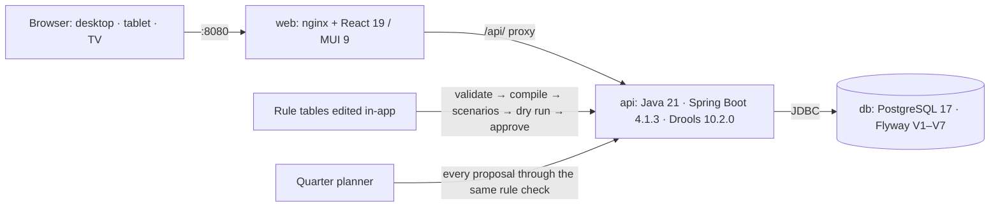

# ShiftCircle build record

**What it is:** a working prototype that schedules 8, 12 and 16-hour shifts at a fictional 24/7 provincial correctional centre. Supervisors plan against a Drools rules engine whose rules non-technical staff edit as decision tables; a quarter planner builds the next 14 weeks through the same engine; time feeds a simulated payroll export. All data is synthetic, and it isn't an official Government of Saskatchewan service. Setup: `README.md` § Setup.

## 1. Architecture

Only the web publishes a port. A published rule version is compiled and swapped in without a redeploy. A change goes: preview → save → `422` with plain reasons → acknowledge a warning, or override an emergency-policy Block with a reason → audit event (ADR-014). The planner writes only a draft until commit; commit re-checks every row and writes the quarter in one transaction (ADR-026).

## 2. Key decisions

- No AI at runtime: the rules engine decides and a supervisor approves (ADR-002, ADR-005). Drools tables are edited in the app; publishing uses maker/checker, test scenarios and a dry run (ADR-012).
- Coverage is by unit and block, measured hourly in absolute time (the NIGHT block on D is 23:00 D–07:00 D+1). Overtime is hours over the pay-period threshold (ADR-013, 016, 017).
- Baseline rule set v2 (V6) is seeded PUBLISHED by migration, like v1, without maker/checker or an audit row; every later version uses maker/checker (ADR-027, docs/04 §6).
- **Phase 3 (ADR-026/027):** the planner builds seven 14-day periods from Mon 4 Jan 2027 with a deterministic heuristic; the 8 h default is rotating 5 on / 2 off (weekends rotate; fixed 5/2 and 7/3 are selectable and show their warnings); every proposal is engine-checked and a Block leaves a visible gap; commit needs the warning list accepted once and an `If-Match`. V6 adds D12 07–19 / N12 19–07 and additive rule-set v2; only 12 h crews work nights. Dataset 120 is 100 full-time crews + 20 casual relief officers, selected from the About reset card; the 100 seed stays untouched. Planned absences are a read-only input; where a time entry exists, rule facts use the actual end.
- **Deviations confirmed by the project lead on 2026-11-20:** only emergency Blocks can be overridden (ADR-023); lock and export are facility-wide (ADR-022); cross-unit cover (ADR-024). Audit relies on triggers, not grants (ADR-018, prototype only).

## 3. AI-assisted development

**Who and independence.** Claude Opus 5.5 did the design and specs, the phase 3 UI spec and the demo script. From 2026-11-20 an OpenRig team built and verified it: builders dev-build and dev-build2 on DeepSeek V4.1 Flash (dev-build2 on MiniMax until 05:06Z), verifiers dev-qa and review-r2 on GLM 5.3 then GLM 5.3 Flash, final security review-r3 on Claude Sonnet 5.5, lead Claude Sonnet 5.5. Builders and verifiers are different families except about **10:07Z–11:30Z on 2026-11-20** (all OpenCode seats on MiniMax, R32–R34, weaker independence); the phase 3 verification (R48–R61) is independent of the authors. dev-design's visual and demo walks are independent of the API authors but not of the UI spec it wrote.

**How it was verified:** 61 review and QA rounds, the e2e runs and two visual reviews, each with what was checked, found and fixed (`docs/review-rounds.md`; narrative in `docs/ai-dev-log.md`). Fixes were proved by reverting them and watching their test fail.

**What verification caught** that had passed the author's own tests:

| Defect | Caught by | Ref. |
|---|---|---|
| **Remote code execution through a rule edit** (unescaped values in generated Drools source; no approval needed). Fixed in three layers, each enough alone | review-r2 ran a payload | R24, R28 |
| **Concurrent saves passed a Block rule**; now a per-officer lock. An open-shift **double fill** and an **unscoped roster list** were missed by earlier passes and closed later | review-r2; review-r3 | R13, R16, R40, R42 |
| **Source missing from git, twice** (`.gitignore` lines hid Java packages); now a guard script. Counts are quoted only from a clean checkout | review-r2, builder | R5, log #25, #58 |
| **Stale wall display looked live and overflowed**; automated checks covered only the live state | visual review | Visual, R27 |
| **Blank page for the auditor**, a raw 500 whose handler was tested only directly, the payroll lock on the real clock, a test-order bug, a flaky web suite | dev-qa, real-api e2e | R25–R37 |
| **Phase 3:** candidate 1 named the 120 officers First92 Last92, showed commit time in UTC, raw FTE keys and a 150-dataset note; candidate 2 scored D12/N12 preferences as 8 h DAY (scorecard 68 vs Compare 195); the 120 commit collided with a seeded pay period; the planner's actual-time seam was unpinned | dev-design, review-r2 | R54–R59 |

**Suggestions corrected or rejected.** The lead rejected a custom rule catalogue and 16 h shifts as overtime-only (log #5, #13); the builder rejected a catch-all handler that hid `403`s as `500`s, then built it safely (log #69). In phase 3 the lead's 7/3 default was replaced by rotating 5/2, the "rotating is warning-free" claim was wrong and is now stated with its cost, "the gaps are mostly sizing" was wrong (727 gaps of 1,764 on 100), the dataset name was corrected from 150 to 120, and the two extra patterns were measured and not added (decisions 15–16; log #96–97).

## 4. Test cases and verified status

**Final state (`5d0f810`, independently verified).** API **422 = 123 rules + 27 infrastructure + 272 api**, 0 failures/errors/skipped in the default order and random seed 20261121; web **277**; Playwright real api, a fresh stack per viewport, desktop **101/0**, tablet **100 + 1 skipped/0**; fixtures **22/21**. Checksums: 100 roster and 84 periods `3390148255…6539`, payroll golden `d502848d…d06a`, 120 `82b19cf8…32ca`. dev-qa ran the final pipeline; review-r2 reviewed the planner, actuals and rule-set v2; review-r3 ran the final security pass; dev-design walked the demo.

| ID | Case | Expected | Result |
|---|---|---|---|
| T2 | 12 h shift, then 8 h after 7 h rest | BLOCK, nothing saved | 422, **no override** (R12, R30) |
| T3 | Exactly 8 h of rest | U-01 PASS, U-02 WARN | 8 h 00 m PASS, 7 h 59 m BLOCK (R4, R7) |
| T8 | Payroll export, locked period | Equals the golden file | Recomputed independently; byte-identical (R17, R33) |
| T9 | 17 h in a lockdown | Needs a reason ≥ 10 chars | Short refused; audited (R12, R13) |
| P3 | Quarter plan on dataset 120 | Engine-checked draft, honest gaps, guarded commit | 38 gaps / 7 warnings / zero Block; 5,103 shifts on commit; re-walked twice (R60), 422 both orders (R61) |

## 5. Governance and ministry suitability

- **Synthetic data, no secrets:** 100 fictional officers (or the 120 crew dataset); weak secrets are refused; the history has no `.env` or keys (R30, R61).
- **Safeguards:** emergency overrides need a written reason and are audited; other Blocks can't be overridden; maker/checker; rule input is untrusted; the planner's commit re-checks and never implies an override.
- **Privacy:** role and unit scope on every endpoint (`404` outside); the wall display shows counts only (R26); the planner reads every unit but writes only drafts.
- **Honest limits:**
  - **No human reviewed the rule boundary tests.** Guardrail 4 required it; the lead waived it on 2026-11-20 and AI verifiers reviewed them instead (R4–R7).
  - **Locked periods:** time entries are guarded by the api and a trigger, but shifts only by the api: a raw SQL `UPDATE` can still cancel one (R38). The audit table is append-only by trigger. Rule ranges are sanity bounds, not business validation: 280 of 297 hostile values were refused, but a wrong yet legal value (such as a 0.5 h overtime threshold) is stopped only by maker/checker, the scenarios and the dry run (R40).
  - **Tokens and scope:** 8 h, no revocation, memory-only (ADR-025); mock sign-in issuer; nginx master runs as root. **Not built:** the Excel round-trip, the employee planner and proposals inbox, offer withdrawal, a payroll-clerk role, arrow-key grid navigation and the OpenAPI document (docs/10 §8).
  - **Planner:** qualifications are not enforced (0 failing block-days on 120 by construction, 346 on the 100 seed); no leave is seeded and the absence input is a read-only skip; payroll overtime stays per period (P-01), not cycle-averaged; a late-recorded actual is not re-checked; rule set v2 is seeded by V6; 16 h exists only in the 2026 seed; 13 shift-less casuals still read their wishes as MET (candidate 4, not built); the two extra patterns were measured and not added. **U-14:** at exactly 60.00 h the week is a WARN; the Block is above it, as docs/05, docs/10 and the test say.

## 6. Next steps (pilot)

1. A practitioner reviews the rule boundary tests, and the centre validates the MOCK values.
2. Government SSO with short-lived tokens; a payroll-clerk role for lock and export.
3. Separate database roles, with insert-only audit and a locked-period guard on shifts (ADR-018). Also non-root containers, TLS, a secrets manager, and CI with image scanning (`docs/08-deployment.md` §9).
