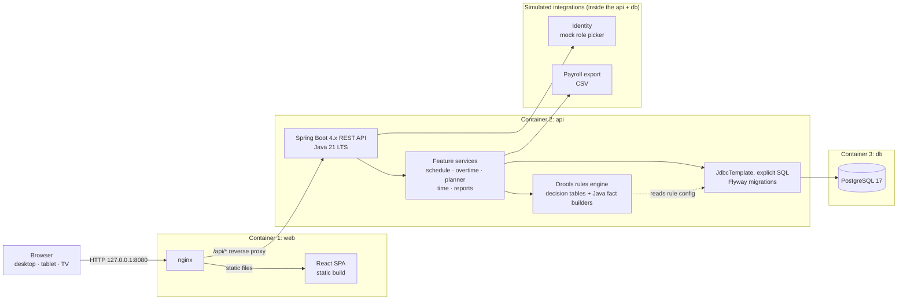
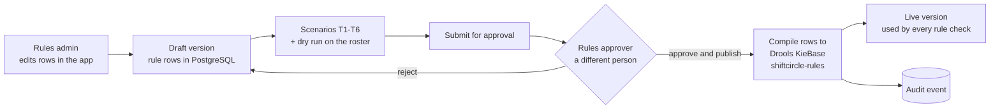
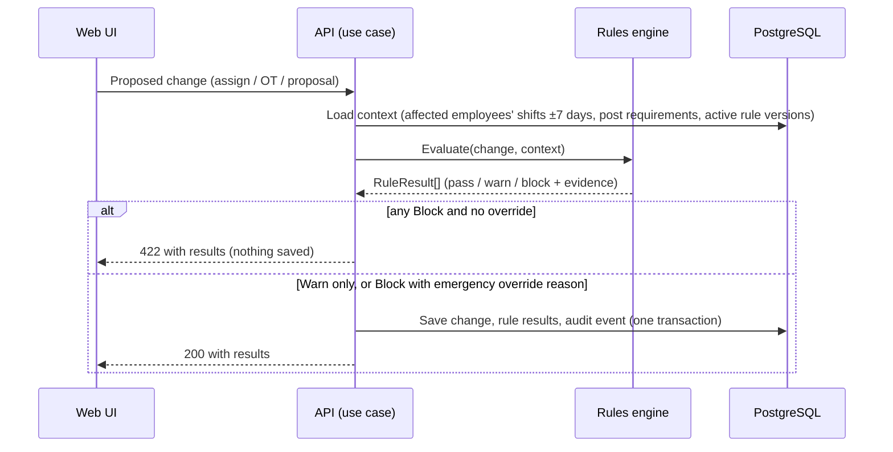

# ShiftCircle — Architecture

**Status:** v0.6 · 2026-11-24 (describes the system as built) · Middle tier: Java + Spring Boot (ADR-011); rules engine: Drools decision tables (ADR-012).

**Detailed specs:** data model `06-data-model.md` · API `07-api-spec.md` · deployment `08-deployment.md` · access control `09-access-control.md` · testing `10-testing.md` · UI `ui/README.md`. Handover: `process/HANDOFF.md`.

## 1. Deployment: three containers



- **Container 1, web:** nginx serves the compiled React app and reverse-proxies `/api` to the API. Everything comes from one origin, so there's no CORS setup.
- **Container 2, api:** a stateless Spring Boot REST API, built with Maven and run on an Eclipse Temurin JRE 21 image (multi-stage Docker build). Spring Boot Actuator provides health checks for compose. The rules engine (Drools, embedded) is a separate Maven module, so it can be unit-tested on its own and reused later by a batch validator.
- **Container 3, db:** PostgreSQL, with a named volume. Flyway migrations run on API startup; the synthetic seed generator runs under the `demo` Spring profile.
- **Simulated integrations** live inside the API and DB as tables, endpoints and screens, so there's no fourth container. Payroll is a CSV download; identity is a mock sign-in that issues an HS256 bearer JWT, which the API validates on every request.

## 2. Logical layers (api)

```
Maven multi-module build (ca.shiftcircle.*)

shiftcircle-api            → the Spring Boot app. Feature-sliced packages (assignments, audit, auth, coverage, csv, demo,
                             display, overtime, payroll, planner, reports, rulesets, schedule, time, units, …); each slice holds its
                             @RestController, its service and its JdbcTemplate SQL. Also Spring Security, the JWT filter, error mapping
shiftcircle-rules          → Drools rule templates, fact builders (rest gaps, rolling hours, consecutive runs), rule-base compiler and
                             publish pipeline; no Spring dependency, unit-tested on its own
shiftcircle-infrastructure → Flyway migrations, health, the demo seed generator
shiftcircle-domain         → empty placeholder (a package-info only)
shiftcircle-application    → empty placeholder (a package-info only)
tests                      → JUnit 5 + AssertJ for the rules boundary tests; Spring Boot tests with Testcontainers PostgreSQL for
                             the api and repositories
```

**What is real, and what isn't.** The design started with a layered `domain` / `application` / `infrastructure` split (entities in `domain`, use cases in `application`). The build did not follow it: each feature is a vertical slice in `shiftcircle-api` (controller → service → SQL), and the only module with its own behaviour is `shiftcircle-rules`, which has no Spring dependency and is tested by itself (`shiftcircle-infrastructure` holds only the Flyway migrations, the health check and the demo seed generator). The `domain` and `application` modules are **kept as empty placeholders** so the module list stays stable; they hold no code, and nothing depends on them for behaviour. Extracting a real domain layer is a roadmap item (`docs/roadmap.md`, package 10), not a prototype goal.

**Persistence is explicit SQL, not an ORM.** Every query is a `JdbcTemplate` call with parameters (`?`/named), which keeps the data access visible and reviewable (and the audit and locked-period triggers live in the schema, not in entity callbacks). There is **no JPA/Hibernate, no springdoc/OpenAPI and no Bean Validation** in the build: request checks are written in the services, and `web/src/api/types.ts` is kept in step with the API by hand (NFR-09 and the generated contract are roadmap items).

### Rule change and publish flow

Rule tables are data, not code. A new rule version goes through maker/checker and a dry run before the engine uses it (ADR-012, ADR-027; docs/04 §6).



The planner, the planning board, overtime offers and draft edits all call the same engine, so a published version applies everywhere at once.

## 3. Key flow: any schedule change



Write operations take a "preview" flag, so the UI can show rule results live before the user commits.

## 4. Frontend

- **React + TypeScript + Vite**, with **MUI** (`@mui/material`) as the design system and `react-router-dom` for routing. The roster grid and the coverage chart are built in-house (a CSS grid and MUI `Box`); a small `fetch` wrapper (`web/src/api/http.ts`) handles API calls, with no query library and no MUI X.
- **Responsive layouts:** a side navigation on desktop; a collapsible navigation and touch-sized targets on tablet; and `/display` as a TV route with no navigation, large type, the high-contrast theme and a 60-second auto-refresh.
- **Role-aware routing:** the employee and supervisor areas are separate, and the API enforces the same boundaries.

## 4a. Middle-tier libraries

| Concern | Choice |
|---|---|
| Runtime | Java 21 (LTS), Spring Boot 4.x |
| Rules | Drools 10.x (Apache KIE) embedded via the KIE API: `drools-templates`, `drools-decisiontables`; Apache POI for Excel import/export (future work: not built, not a dependency in the prototype) |
| Web / API | Spring Web MVC. Request validation is hand-written in the services; there is no Bean Validation and no springdoc/OpenAPI (not built) |
| Persistence | Spring `JdbcTemplate` with explicit, parameterised SQL; PostgreSQL JDBC driver; Flyway. No JPA/Hibernate |
| Rule tables | Rows stored in PostgreSQL with versions; compiled into a Drools KieBase on publish |
| Security | Spring Security: an HS256 JWT sent as `Authorization: Bearer …`, issued by the mock sign-in and validated on every request (`JwtService`); method-level role checks (`@PreAuthorize`) and unit scope (`ScopeGuard`) |
| Ops | Spring Boot Actuator (health, info); structured JSON logs |
| Tests | JUnit 5, AssertJ, Spring Boot Test, Testcontainers (PostgreSQL) |
| Build | Maven (wrapper included), multi-stage Dockerfile |

## 5. Security and governance in the architecture

| Concern | Prototype | For a pilot |
|---|---|---|
| Identity | Mock role picker; API reads roles from the HS256 bearer JWT | Government SSO (e.g. Entra ID / OIDC); roles from HR groups |
| Secrets | `.env.example` only; local defaults | Secrets store; no defaults |
| Data | Synthetic only | Privacy impact assessment (PIA) under FOIP; retention schedule; residency in Canada |
| Audit | Append-only table (no update or delete through the API) | Database role permissions, log shipping, tamper evidence |
| Transport | HTTP on localhost | TLS at the ingress |
| Integrations | Payroll CSV | Payroll interface specification; email/SMS gateway when notifications are added |

## 6. What's simulated

Identity and sign-on, the payroll system (we produce the export file, nobody receives it), the HR employee source (seed data), and real clock-in (actuals are entered by a supervisor).
