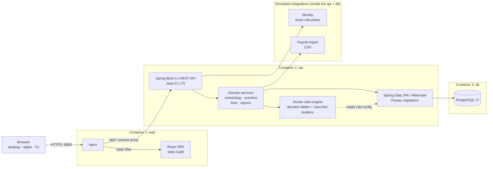
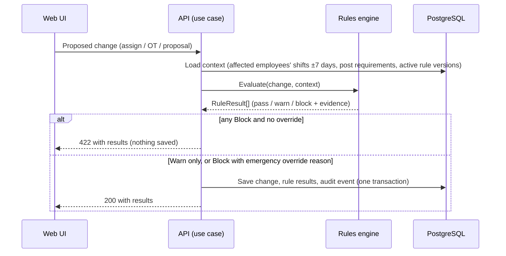

# ShiftCircle — Architecture

**Status:** Draft v0.5 · 2026-11-19 · Middle tier: Java + Spring Boot (ADR-011); rules engine: Drools decision tables (ADR-012).

**Detailed specs:** data model `06-data-model.md` · API `07-api-spec.md` · deployment `08-deployment.md` · access control `09-access-control.md` · testing `10-testing.md` · UI `ui/README.md`. Handover: `../HANDOFF.md`.

## 1. Deployment: three containers



- **Container 1, web:** nginx serves the compiled React app and reverse-proxies `/api` to the API. Everything comes from one origin, so there's no CORS setup.
- **Container 2, api:** a stateless Spring Boot REST API, built with Maven and run on an Eclipse Temurin JRE 21 image (multi-stage Docker build). Spring Boot Actuator provides health checks for compose. The rules engine (Drools, embedded) is a separate Maven module, so it can be unit-tested on its own and reused later by a batch validator.
- **Container 3, db:** PostgreSQL, with a named volume. Flyway migrations run on API startup; the synthetic seed generator runs under the `demo` Spring profile.
- **Simulated integrations** live inside the API and DB as tables, endpoints and screens, so there's no fourth container. Payroll is a CSV download; identity is a header set by the mock sign-in.

## 2. Logical layers (api)

```
Maven multi-module build (ca.shiftcircle.*)

shiftcircle-api            → @RestController endpoints, Spring Security config, springdoc OpenAPI, DTOs, validation
shiftcircle-application    → @Service use cases (AssignShift, OfferOvertime, SubmitProposal, LockPayPeriod, …), @Transactional boundaries
shiftcircle-rules          → Drools rule templates, fact builders (rest gaps, rolling hours, consecutive runs), rule-base compiler and publish pipeline; no Spring dependency
shiftcircle-domain         → entities and value objects (Shift, Block, Employee, Post, TimeEntry), Java records where immutable
shiftcircle-infrastructure → Spring Data JPA repositories, Flyway migrations, simulation seed generator, CSV export
tests (per module)         → JUnit 5 + AssertJ for rules boundary tests; Spring Boot tests with Testcontainers PostgreSQL for use cases
```

## 3. Key flow: any schedule change



Write operations take a "preview" flag, so the UI can show rule results live before the user commits.

## 4. Frontend

- **React + TypeScript + Vite**, with **MUI** as the design system and **MUI X Data Grid / Charts** (free MIT tiers). TanStack Query handles API state.
- **Responsive layouts:** a side navigation on desktop; a collapsible navigation and touch-sized targets on tablet; and `/display` as a TV route with no navigation, large type, the high-contrast theme and a 60-second auto-refresh.
- **Role-aware routing:** the employee and supervisor areas are separate, and the API enforces the same boundaries.

## 4a. Middle-tier libraries

| Concern | Choice |
|---|---|
| Runtime | Java 21 (LTS), Spring Boot 4.x, subject to the Day 1 Drools compatibility spike (fallback: Spring Boot 3.5.x) |
| Rules | Drools 10.x (Apache KIE) embedded via the KIE API: `drools-templates`, `drools-decisiontables`; Apache POI for Excel import/export (future work: not built, not a dependency in the prototype) |
| Web / API | Spring Web MVC, Bean Validation, springdoc-openapi (Swagger UI in dev) |
| Persistence | Spring Data JPA (Hibernate), PostgreSQL JDBC driver, Flyway |
| Rule tables | Rows stored in PostgreSQL with versions; compiled into a Drools KieBase on publish |
| Security | Spring Security: a dev-only signed token from the mock sign-in; method-level role checks (`@PreAuthorize`) |
| Ops | Spring Boot Actuator (health, info); structured JSON logs |
| Tests | JUnit 5, AssertJ, Spring Boot Test, Testcontainers (PostgreSQL) |
| Build | Maven (wrapper included), multi-stage Dockerfile |

## 5. Security and governance in the architecture

| Concern | Prototype | For a pilot |
|---|---|---|
| Identity | Mock role picker; API checks roles from a signed dev token | Government SSO (e.g. Entra ID / OIDC); roles from HR groups |
| Secrets | `.env.example` only; local defaults | Secrets store; no defaults |
| Data | Synthetic only | Privacy impact assessment (PIA) under FOIP; retention schedule; residency in Canada |
| Audit | Append-only table (no update or delete through the API) | Database role permissions, log shipping, tamper evidence |
| Transport | HTTP on localhost | TLS at the ingress |
| Integrations | Payroll CSV | Payroll interface specification; email/SMS gateway when notifications are added |

## 6. What's simulated

Identity and sign-on, the payroll system (we produce the export file, nobody receives it), the HR employee source (seed data), and real clock-in (actuals are entered by a supervisor).
