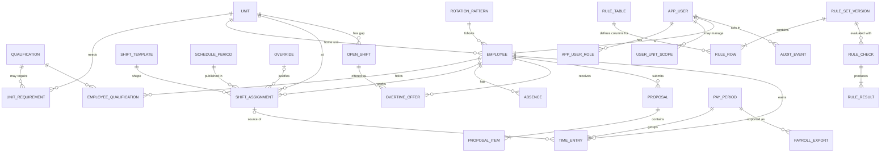

# ShiftCircle — Data Model

**Status:** Draft v1.0 · 2026-11-19 · PostgreSQL 17 · migrations managed by Flyway

## 1. Principles

- **Synthetic data only.** Every person row carries `is_synthetic = true`; the UI footer says so.
- **Time:** instants are `timestamptz` stored in UTC. Business dates (work date, pay period) use `America/Regina`. A shift's `work_date` is the local date it **starts** on.
- **Keys:** `uuid` primary keys (generated by the app), except `audit_event` (`bigint` identity, for ordering).
- **Data minimization:** absences store a *type* only (sick, vacation, other), never a medical reason or free-text diagnosis.
- **History is kept, not overwritten:** rule sets are versioned, assignments are cancelled rather than deleted, and the audit log is append-only.
- **Optimistic locking:** editable rows carry `version int`. The API sends it back as an ETag.

## 2. Entity-relationship overview

## 3. Tables

### 3.1 Facility and people

| Table | Key columns | Notes and constraints |
|---|---|---|
| `unit` | `id`, `code` (unique), `name`, `kind` (`LIVING`, `ADMISSIONS`, `CONTROL`, `ESCORT`, `OTHER`), `allows_12h` bool, `allows_16h` bool, `active` | `allows_12h` / `allows_16h` implement rule S-03 (12- and 16-hour patterns need a local agreement). |
| `qualification` | `id`, `code` (unique, e.g. `CONTROL`, `ESCORT`, `FIRST_AID`), `name` | |
| `unit_requirement` | `id`, `unit_id`, `block` (`DAY` 07–15, `EVENING` 15–23, `NIGHT` 23–07), `min_staff`, `qualification_id` null, `min_with_qualification`, `effective_from`, `effective_to` | Coverage is measured **by unit and block** (ADR-013). Unique on (`unit_id`, `block`, `effective_from`). |
| `shift_template` | `id`, `code`, `label`, `start_time`, `duration_minutes` (480, 720, 960), `regular_allowed` bool, `chip_style`, `active`, `effective_from`, `effective_to`, `rule_set_version_id` | **Configurable** (ADR-015). Defaults: `D8` 07:00–15:00, `E8` 15:00–23:00, `N8` 23:00–07:00, `A12` 00:00–12:00, `P12` 12:00–24:00, `L16` 20:00–12:00 (regular, rule L-01). Changing a template never alters existing assignments, which keep their own `start_at`/`end_at`. |
| `rotation_pattern` | `id`, `code`, `name`, `cycle_days`, `pattern` jsonb (e.g. `["A12","A12","P12","P12",null,null,null,null]`), `anchor_date` | Drives the seed generator and future roster building. |
| `employee` | `id`, `employee_no` (unique), `first_name`, `last_name`, `classification` (`CO`), `home_unit_id`, `rotation_pattern_id`, `fte` numeric(3,2), `seniority_date`, `active`, `is_synthetic` | |
| `employee_qualification` | (`employee_id`, `qualification_id`) PK, `valid_from`, `valid_to` | Expiry supports "certification lapsed" checks later. |

**Coverage rule (ADR-013, revised):** coverage is measured **hourly**. Each block's `min_staff` applies to every hour in the block; a block is covered when every hour meets it. A 12-hour 00:00–12:00 shift therefore counts toward the last 7 hours of the Night block and the first 5 hours of the Day block.

### 3.2 Scheduling

| Table | Key columns | Notes and constraints |
|---|---|---|
| `schedule_period` | `id`, `unit_id`, `start_date`, `end_date`, `status` (`DRAFT`, `PUBLISHED`), `published_at`, `published_by` | Changes after publishing trigger notice checks (S-01, P-05). |
| `shift_assignment` | `id`, `employee_id`, `unit_id`, `shift_template_id`, `schedule_period_id`, `start_at`, `end_at`, `work_date`, `kind` (`ROSTERED`, `EXTRA`), `source` (`ROTATION`, `MANUAL`, `OVERTIME_OFFER`, `PROPOSAL`), `status` (`PLANNED`, `CANCELLED`), `override_id` null, `created_by`, `created_at`, `version` | `EXTRA` = picked up beyond the roster (e.g. from an overtime offer). **Overtime isn't stored on the shift**; it's computed from hours in the pay period (P-01). `CHECK (end_at > start_at)`. **No double-booking:** `EXCLUDE USING gist (employee_id WITH =, tstzrange(start_at, end_at) WITH &&) WHERE (status <> 'CANCELLED')` (needs `btree_gist`). **Known limit:** no trigger guards locked pay periods on this table. The locked-period wall here is the api's `409` only, so a raw SQL `UPDATE` can still cancel a shift inside a locked period (dev-qa did this on its own stack). `time_entry` has both the `409` and a trigger. A pilot adds a trigger here, or separate owner and application database roles (ADR-018). |
| `absence` | `id`, `employee_id`, `shift_assignment_id` null, `type` (`SICK`, `VACATION`, `OTHER`), `start_at`, `end_at`, `recorded_by`, `recorded_at` | Type only: no medical details (FOIP data minimization). |
| `override` | `id`, `reason` text `CHECK (length(reason) >= 10)`, `rule_codes` text[], `rule_set_version_id`, `created_by`, `created_at` | Every Block that was overridden links here. Reported in Reports and the audit log. |
| `open_shift` | `id`, `unit_id`, `shift_template_id`, `start_at`, `end_at`, `reason` (`SICK_CALL`, `VACATION`, `EXTRA_COVERAGE`, `OTHER`), `status` (`OPEN`, `OFFERED`, `FILLED`, `CANCELLED`), `filled_assignment_id` null, `created_by` | |
| `overtime_offer` | `id`, `open_shift_id`, `employee_id`, `rank`, `ordered` bool, `status` (`OFFERED`, `ACCEPTED`, `DECLINED`, `CONFIRMED`, `WITHDRAWN`, `EXPIRED`), `rule_snapshot` jsonb, `offered_by`, `offered_at`, `responded_at` | `rule_snapshot` keeps the eligibility result at offer time, for audit. Unique on (`open_shift_id`, `employee_id`). `CONFIRMED` was added by V4: the supervisor's confirmation is a distinct state from the employee's acceptance. |
| `proposal` | `id`, `employee_id`, `note`, `status` (`SUBMITTED`, `ACCEPTED`, `PARTIAL`, `DECLINED`), `submitted_at`, `decided_by`, `decided_at` | Shift planner (F9). |
| `proposal_item` | `id`, `proposal_id`, `action` (`ADD`, `REMOVE`, `CHANGE`), `target_assignment_id` null, `shift_template_id`, `unit_id`, `start_at`, `end_at`, `decision` (`PENDING`, `ACCEPTED`, `DECLINED`), `rule_snapshot` jsonb | |

### 3.3 Time and payroll handoff

| Table | Key columns | Notes and constraints |
|---|---|---|
| `pay_period` | `id`, `start_date`, `end_date` (14 days), `status` (`OPEN`, `LOCKED`), `locked_at`, `locked_by`, `unlock_reason` | Unique, non-overlapping date ranges. |
| `time_entry` | `id`, `employee_id`, `pay_period_id`, `shift_assignment_id` null, `work_date`, `start_at`, `end_at`, `hours` numeric(5,2), `entry_type` (`SCHEDULED`, `ACTUAL`), `absence_type` null, `pay_code` (`REG`, `OT15`, `OT20`, `SICK`, `VAC`, `STAT`), `rule_set_version_id`, `recorded_by`, `created_at` | Pay codes come from the pay-classification rule table: the period's actual hours, in time order, are `REG` up to the threshold (default 80 h) and overtime beyond it. Codes are recalculated for the whole period after any change and frozen on lock. A trigger rejects inserts and updates when the pay period is `LOCKED`. |
| `payroll_export` | `id`, `pay_period_id`, `generated_at`, `generated_by`, `row_count`, `file_sha256` | The file isn't stored; the hash proves what was sent. |

### 3.4 Rules engine

| Table | Key columns | Notes and constraints |
|---|---|---|
| `rule_table` | `id`, `code` (`REST`, `MAX_HOURS`, `CONSECUTIVE`, `LONG_SHIFTS`, `DAYS_OFF`, `PAY`, `OT_RANKING`, `SHIFT_LENGTHS`), `name`, `template_ref`, `column_schema` jsonb | Defines the friendly columns an admin edits; `template_ref` points at the Drools template in the code. |
| `rule_set_version` | `id`, `version` int unique, `status` (`DRAFT`, `SUBMITTED`, `APPROVED`, `PUBLISHED`, `SUPERSEDED`, `REJECTED`), `based_on_version`, `effective_from`, `change_reason`, `created_by`, `submitted_at`, `approved_by`, `approved_at`, `published_at`, `build_report` jsonb, `dry_run_report` jsonb, `drl_sha256` | **Maker/checker:** `CHECK (approved_by IS NULL OR created_by IS NULL OR approved_by <> created_by)` (matches `V1__schema.sql`; the `created_by IS NULL` arm only makes explicit what a CHECK already allows, since a CHECK that evaluates to NULL passes; the API always sets `created_by`). Only one `PUBLISHED` row per effective date. |
| `rule_row` | `id`, `rule_set_version_id`, `rule_table_id`, `code` (e.g. `U-03`), `enabled`, `params` jsonb, `severity` (`BLOCK`, `WARN`, `INFO`), `override_policy` (`EMERGENCY`, `ACKNOWLEDGE`, `NONE`), `message`, `source`, `is_placeholder`, `sort_order` | `params` validated against `rule_table.column_schema`. Unique on (`rule_set_version_id`, `code`). |
| `rule_check` | `id`, `change_type`, `payload` jsonb, `rule_set_version_id`, `outcome` (`PASS`, `WARN`, `BLOCK`), `requested_by`, `created_at`, `saved` bool | Stored for every **saved** change (previews aren't stored). |
| `rule_result` | `id`, `rule_check_id`, `rule_code`, `outcome`, `message`, `facts` jsonb, `evidence_assignment_ids` uuid[] | E.g. `facts = {"restHours": 0, "minHours": 8}`. |

### 3.5 Users and audit

| Table | Key columns | Notes and constraints |
|---|---|---|
| `app_user` | `id`, `username` unique, `display_name`, `employee_id` null, `active` | Mock sign-in picks from this table (see `09-access-control.md`). |
| `app_user_role` | (`user_id`, `role`) PK | Roles: `EMPLOYEE`, `SUPERVISOR`, `RULES_ADMIN`, `RULES_APPROVER`, `AUDITOR`, `DISPLAY`, `PLANNER`. |
| `user_unit_scope` | (`user_id`, `unit_id`) PK | Which units a supervisor manages. |
| `audit_event` | `id` bigint identity, `occurred_at`, `actor_user_id`, `action`, `entity_type`, `entity_id`, `before` jsonb, `after` jsonb, `rule_set_version_id` null, `override_id` null, `correlation_id` | **Append-only:** triggers raise an error on `UPDATE`, `DELETE` and `TRUNCATE`. The prototype has one database user, so there are no role grants yet; a pilot adds an application role with `INSERT, SELECT` only (ADR-018). |

### 3.6 Planner (ADR-026)

| Table | Key columns | Notes and constraints |
|---|---|---|
| `officer_preference` | `employee_id` PK, `shift_length` (8/12/16), `time_of_day` (`DAY`/`EVENING`/`NIGHT`/`NONE`), `days_off` text[], `max_days_off` (default 2), `updated_at`, `updated_by` | Soft wishes, not rules. Seeded synthetically for the demo officers from the dataset seed and the officer number (not part of the roster checksum). |
| `plan_draft` | `id`, `from_date`, `to_date`, `seed`, `pattern8h` (`ROTATING_5_2`/`5_ON_2_OFF`/`7_ON_3_OFF`), `status` (`DRAFT`/`COMMITTED`/`DISCARDED`), `version`, `created_by`, `created_at`, `generated_ms`, `scorecard` jsonb, `warnings` jsonb, `warning_count`, `committed_at`, `committed_by` | One open draft (`partial unique index ... where status = 'DRAFT'`). `version` is the commit ETag. |
| `plan_draft_assignment` | `id`, `draft_id`, `employee_id`, `unit_id`, `shift_template_id`, `work_date`, `start_at`, `end_at`, `kind`, `sort_order` | Unique on (`draft_id`, `employee_id`, `start_at`). Never read by the planning board; a draft is not a roster. |
| `plan_draft_gap` | `id`, `draft_id`, `unit_id`, `gap_date`, `block`, `required`, `placed`, `reason` | One row per short block-day, visible in the scorecard and the Gaps tab. |
| `shift_assignment.plan_draft_id` | uuid null, references `plan_draft` | Set by commit, so planner-created rows are distinguishable from a supervisor's edits. |

## 4. Indexes (beyond primary and unique keys)

- `shift_assignment (employee_id, start_at)` and `(unit_id, start_at)`: rule context loading and the planning board.
- `time_entry (pay_period_id, employee_id)`: reports and payroll export.
- `overtime_offer (employee_id, status)`: "my offers".
- `audit_event (entity_type, entity_id)` and `(occurred_at)`.
- `rule_row (rule_set_version_id, rule_table_id, sort_order)`.

## 5. Volumes (demo dataset)

| Data | Approximate rows |
|---|---|
| Employees | 100 |
| Shift assignments (90 days) | ~4,800 |
| Time entries (past days; the generator writes `ACTUAL` entries only, and scheduled hours come from the assignments) | ~3,400 (generator run, seed 20261001: 3,366) |
| Overtime offers | ~400 |
| Audit events | ~6,000 after seeding |

Tiny for PostgreSQL. The performance targets (NFR-05) come down to sensible indexes and loading only a ±7-day window of shifts for each rule check.

## 6. Migrations and seed

| Script | Contents |
|---|---|
| `V1__schema.sql` | Extensions (`btree_gist`, `pgcrypto`), types, tables, constraints, triggers (append-only audit, locked pay periods). **No role grants:** the prototype runs as one database user and the triggers are the proof of append-only audit; separate roles and grants are deferred to a pilot (ADR-018). |
| `V2__reference_data.sql` | Shift templates, blocks, qualifications, rule tables, rule set **v1** from `05-union-rules.md` |
| `V3__demo_units_and_users.sql` | Fictional units, unit requirements, demo users and roles |
| Java `DemoDataGenerator` (`demo` profile) | 100 officers, rotations, 90 days of assignments, absences (~4%: 2% sick, 2% vacation, ADR-020), overtime fills, actuals for days before "today", and the planted test cases. Fixed seed, so it's reproducible. Runs only if the database is empty. |
