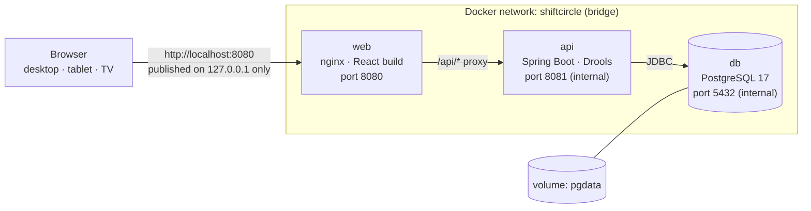

# ShiftCircle — Deployment Specification

**Status:** v1.0, kept in step with `docker-compose.yml` and `.env.example` · Docker Compose, three containers

## 1. Topology



Only **web** publishes a port to the host, bound to **127.0.0.1** (8080 by default; `SC_WEB_PORT` overrides it). It is not reachable from the LAN, because the demo has mock sign-in and a destructive reset. The API and database are reachable only inside the Docker network; a `docker-compose.dev.yml` override exposes them for local debugging, on 127.0.0.1 only (api on 8081, db on 5433 by default).

## 2. Containers

| | web | api | db |
|---|---|---|---|
| Build | Multi-stage: `node:24-alpine` (corepack pnpm, pinned by `packageManager`; `pnpm install --frozen-lockfile`, `pnpm build`) → `nginx:stable-alpine` | Multi-stage: `maven:3.9-eclipse-temurin-21` (mvn verify) → `eclipse-temurin:21-jre-alpine` | `postgres:17-alpine` (official image) |
| Runs as | nginx master as **root**, workers as the `nginx` user (stock `nginx:stable-alpine`; known prototype deviation, see below and §9) | `app` user (non-root), read-only root filesystem, `/tmp` tmpfs | postgres |
| Port | 80 (container), 127.0.0.1:8080 (published) | 8081 (internal) | 5432 (internal) |
| Health check | `wget -qO- http://localhost:80/healthz` | `wget -qO- http://localhost:8081/actuator/health/readiness` | `pg_isready -U $POSTGRES_USER -d $POSTGRES_DB` |
| Depends on | api (healthy) | db (healthy) | — |
| Memory (guide) | 64 MB | 768 MB (`-XX:MaxRAMPercentage=75`) | 256 MB |

**Known prototype deviation (web):** the stock `nginx:stable-alpine` image starts its master process as root so it can bind port 80; only the worker processes drop to the `nginx` user. The api container does run non-root. Hardening for a pilot: switch to `nginxinc/nginx-unprivileged`, which runs entirely as a non-root user and listens on **8080 inside the container** (so the port mapping, `listen` directive and health check move from 80 to 8080).

Image versions are pinned to exact tags (and recorded in the build record) when the build is done.

## 3. `docker-compose.yml` (outline)

```yaml
name: shiftcircle
services:
  db:
    image: postgres:17-alpine
    environment:
      POSTGRES_DB: ${POSTGRES_DB}
      POSTGRES_USER: ${POSTGRES_USER}
      POSTGRES_PASSWORD: ${POSTGRES_PASSWORD}
      TZ: UTC
    volumes: [ "pgdata:/var/lib/postgresql/data" ]
    healthcheck: { test: ["CMD-SHELL", "pg_isready -U $$POSTGRES_USER -d $$POSTGRES_DB"], interval: 5s, retries: 20 }
    networks: [ shiftcircle ]

  api:
    build:
      context: ./api
      args: { GIT_COMMIT: "${SC_GIT_COMMIT:-unknown}" }
    environment:
      SPRING_PROFILES_ACTIVE: ${SC_PROFILE:-demo}
      SPRING_DATASOURCE_URL: jdbc:postgresql://db:5432/${POSTGRES_DB}
      SPRING_DATASOURCE_USERNAME: ${POSTGRES_USER}
      SPRING_DATASOURCE_PASSWORD: ${POSTGRES_PASSWORD}
      SC_JWT_SECRET: ${SC_JWT_SECRET}
      SC_BUSINESS_TZ: America/Regina
      SC_DEMO_TODAY: ${SC_DEMO_TODAY:-2026-11-19}
      SC_DEMO_SEED: ${SC_DEMO_SEED:-20261001}
    depends_on: { db: { condition: service_healthy } }
    healthcheck: { test: ["CMD", "wget", "-qO-", "http://localhost:8081/actuator/health/readiness"], interval: 10s, retries: 30, start_period: 40s }
    read_only: true
    tmpfs: [ /tmp ]
    networks: [ shiftcircle ]

  web:
    build:
      context: ./web
      args: { VITE_PERSIST_DEMO_SESSION: "${VITE_PERSIST_DEMO_SESSION:-}" }
    ports: [ "127.0.0.1:${SC_WEB_PORT:-8080}:80" ]
    depends_on: { api: { condition: service_healthy } }
    healthcheck: { test: ["CMD", "wget", "-qO-", "http://localhost:80/healthz"], interval: 10s }
    networks: [ shiftcircle ]

volumes: { pgdata: {} }
networks: { shiftcircle: {} }
```

## 4. Configuration

All settings come from environment variables. The repo ships **`.env.example` only**, never `.env`.

| Variable | Purpose | Example (local only) |
|---|---|---|
| `POSTGRES_DB` / `POSTGRES_USER` | Database name and user | `shiftcircle` / `shiftcircle` |
| `POSTGRES_PASSWORD` | Database password | *(set by the reviewer: `cp .env.example .env`, then fill in a value)* |
| `SC_JWT_SECRET` | Signing key for mock sign-in tokens (≥ 32 characters) | *(generated)* |
| `SC_PROFILE` | `demo` (seed data, mock sign-in, demo reset) or `prod-like` (no seed, no mock login, no reset). No Swagger UI exists (docs/10 §8) | `demo` |
| `SC_DEMO_TODAY` | The "today" the demo pretends it is, so past and future data line up | `2026-11-19` |
| `SC_DEMO_SEED` | Random seed for the data generator | `20261001` |
| `SC_GIT_COMMIT` | Build information only: the commit `/api/v1/version` reports. Passed as a build argument, so it is fixed when the api image is built (empty reads `unknown`) | *(optional: paste `git rev-parse --short HEAD`)* |
| `SC_WEB_PORT` | Host port for the web, on 127.0.0.1 | `8080` |
| `VITE_PERSIST_DEMO_SESSION` | **Demo session kill switch** (ADR-025 amendment), a build argument of the web image. Unset: on the `demo` profile the web keeps the mock sign-in in `sessionStorage` so a refresh does not sign you out. `false` (exactly): the web never stores the session. Rebuild to apply. `prod-like` never persists either way | *(unset)* |
| `SC_API_PORT` / `SC_DB_PORT` | Only with `docker-compose.dev.yml`: host ports (127.0.0.1) for the api and the database | `8081` / `5433` |

**Secrets:** no default passwords in code or images. If `SC_JWT_SECRET` or `POSTGRES_PASSWORD` is missing, Compose refuses to start (a missing `POSTGRES_PASSWORD` or `SC_JWT_SECRET`), and the API also refuses a `SC_JWT_SECRET` shorter than 32 characters, each with a clear message. For a pilot these come from a secrets manager.

## 5. Startup sequence

1. **db** starts and initializes the volume on first run → healthy.
2. **api** starts → Flyway runs `V1…V13` → on the `demo` profile, if the database is empty, `DemoDataGenerator` creates the 90-day dataset (target under 20 seconds) → the published rule set is compiled into a Drools rule base → readiness turns healthy.
3. **web** starts once the API is healthy → serves the app at `http://localhost:8080`.

## 6. nginx (web container)

- Serves the React build; unknown paths fall back to `index.html` (client-side routes).
- `location /api/` → `proxy_pass http://api:8081/api/;` with `X-Correlation-Id` and `X-Forwarded-*` headers. `/actuator` is **not** proxied.
- Proxy read timeout 60 s, except `POST /api/v1/planner/drafts` (Generate a quarter draft), which gets 180 s: Generate takes seconds on a quiet host but can approach a minute on a cold, loaded one.
- Static assets: gzip, long cache with hashed filenames; `index.html` not cached.
- Security headers: `Content-Security-Policy` (self + Google Fonts: `fonts.googleapis.com` in `style-src` for the stylesheet and `fonts.gstatic.com` in `font-src` for the font files; `connect-src` stays `'self'`, which bounds fetch and beacon egress), `X-Content-Type-Options: nosniff`, `Referrer-Policy: same-origin`, `frame-ancestors 'none'`, `Permissions-Policy` minimal.
- `/healthz` returns 200 for the health check.

## 7. Reviewer commands

| Task | Command |
|---|---|
| First run | `cp .env.example .env` → set the two secrets → `docker compose up --build` |
| Open | `http://localhost:8080` → pick a demo user (supervisor, employee, rules admin, approver, auditor, wall display) |
| Port already in use | `SC_WEB_PORT=9090 docker compose up --build` (and open `http://localhost:9090`) |
| Build without the demo session persistence | set `VITE_PERSIST_DEMO_SESSION=false` in `.env`, then `docker compose up -d --build --wait` |
| Debug api/db from the host | `docker compose -f docker-compose.yml -f docker-compose.dev.yml up --build` (api 8081, db 5433, loopback only) |
| Reset all data | `docker compose down -v && docker compose up -d --build --wait`, or the **Reset the demo data** card on About & version (P. Planner) |
| Logs | `docker compose logs -f api` |
| Run tests | `docker compose --profile test run --rm --build api-test` (Testcontainers needs Docker access; `--build` stops a stale image being reused), or `./mvnw verify` in `api/`. Web and Playwright commands: README §4 and `e2e/README.md` |
| Test stack of your own | always `docker compose -p <name> …` (or `COMPOSE_PROJECT_NAME`) and a different `SC_WEB_PORT`: the file pins `name: shiftcircle` |

Requirements: Docker Desktop or Docker Engine with Compose v2, about 2 GB free memory, port 8080 free (or `SC_WEB_PORT`). No paid services, no licences, no internet needed after images are pulled (Google Fonts falls back to system fonts offline).

## 8. Logging and observability (prototype)

- JSON logs to stdout from all three containers: timestamp, level, correlation ID, user ID (never names), event.
- Actuator exposes `health` and `info` only.
- Rule-set version and git commit shown at `/api/v1/version` and in the UI footer tooltip.

## 9. From prototype to pilot (not built)

| Concern | Prototype | Pilot |
|---|---|---|
| Hosting | Docker Compose on a laptop | Government-approved container platform (e.g. Kubernetes/OpenShift) in a Canadian region |
| Database | Container + volume | Managed PostgreSQL with point-in-time recovery, encrypted at rest |
| Transport | HTTP on localhost | TLS at the ingress; HSTS |
| Identity | Mock sign-in | Government SSO over OIDC (e.g. Entra ID); roles from directory groups |
| Secrets | `.env` file | Secrets manager / vault |
| Container users | web: nginx master runs as root (stock image); api: non-root | web on `nginxinc/nginx-unprivileged` (non-root, listens on 8080 in the container); all containers non-root, read-only root filesystems |
| Database roles | One database user (the image's owner/superuser) runs migrations and the app; audit log protected by triggers (ADR-018) | Separate migration-owner and application roles; the application role has `INSERT, SELECT` only on `audit_event` |
| Logs | stdout | Central log platform; audit log retention per records schedule |
| Releases | `docker compose up --build`; GitHub Actions CI (`.github/workflows/ci.yml`, §10) runs the checks and tests on pull requests | CI pipeline: tests, dependency and image scanning, signed images, staged environments |

## 10. Continuous integration

`.github/workflows/ci.yml` runs on pull requests and pushes to `main`, with no secrets. Three jobs:
- **repo check scripts:** `scripts/check-ignored-sources.sh`, `scripts/check-audit-codes.sh`, and a check that the dev override binds exactly three ports on 127.0.0.1;
- **web:** `pnpm lint`, `tsc -b`, `pnpm test`, `pnpm build`;
- **api:** `mvn -B verify` through the `api-test` compose service (Testcontainers), with a throwaway `.env`.

Playwright end-to-end is **not** in CI: it needs a fresh stack per viewport, and a Linux runner recipe is unverified. Run it locally (`e2e/README.md`).
