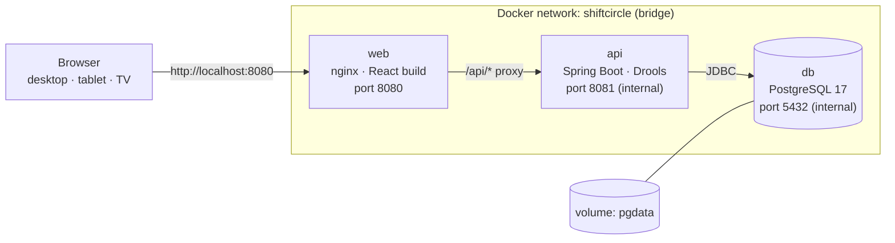

# ShiftCircle — Deployment Specification

**Status:** Draft v1.0 · 2026-11-19 · Docker Compose, three containers

## 1. Topology



Only **web** publishes a port to the host. The API and database are reachable only inside the Docker network; a `docker-compose.dev.yml` override exposes them for local debugging.

## 2. Containers

| | web | api | db |
|---|---|---|---|
| Build | Multi-stage: `node:24-alpine` (npm ci, vite build) → `nginx:stable-alpine` | Multi-stage: `maven:3.9-eclipse-temurin-21` (mvn verify) → `eclipse-temurin:21-jre-alpine` | `postgres:17-alpine` (official image) |
| Runs as | nginx user (non-root) | `app` user (non-root), read-only root filesystem, `/tmp` tmpfs | postgres |
| Port | 8080 (published) | 8081 (internal) | 5432 (internal) |
| Health check | `wget -qO- http://localhost:8080/healthz` | `wget -qO- http://localhost:8081/actuator/health/readiness` | `pg_isready -U $POSTGRES_USER -d $POSTGRES_DB` |
| Depends on | api (healthy) | db (healthy) | — |
| Memory (guide) | 64 MB | 768 MB (`-XX:MaxRAMPercentage=75`) | 256 MB |

Image versions are pinned to exact tags (and recorded in the build record) when the build is done.

## 3. `docker-compose.yml` (outline)

```yaml
name: shiftcircle
services:
  db:
    image: postgres:17-alpine
    environment:
      POSTGRES_DB: ${POSTGRES_DB}
      POSTGRES_USER: ${POSTGRES_USER}
      POSTGRES_PASSWORD: ${POSTGRES_PASSWORD}
      TZ: UTC
    volumes: [ "pgdata:/var/lib/postgresql/data" ]
    healthcheck: { test: ["CMD-SHELL", "pg_isready -U $$POSTGRES_USER -d $$POSTGRES_DB"], interval: 5s, retries: 20 }
    networks: [ shiftcircle ]

  api:
    build: ./api
    environment:
      SPRING_PROFILES_ACTIVE: ${SC_PROFILE:-demo}
      SPRING_DATASOURCE_URL: jdbc:postgresql://db:5432/${POSTGRES_DB}
      SPRING_DATASOURCE_USERNAME: ${POSTGRES_USER}
      SPRING_DATASOURCE_PASSWORD: ${POSTGRES_PASSWORD}
      SC_JWT_SECRET: ${SC_JWT_SECRET}
      SC_BUSINESS_TZ: America/Regina
      SC_DEMO_TODAY: ${SC_DEMO_TODAY:-2026-11-19}
      SC_DEMO_SEED: ${SC_DEMO_SEED:-20261001}
    depends_on: { db: { condition: service_healthy } }
    healthcheck: { test: ["CMD", "wget", "-qO-", "http://localhost:8081/actuator/health/readiness"], interval: 10s, retries: 30, start_period: 40s }
    read_only: true
    tmpfs: [ /tmp ]
    networks: [ shiftcircle ]

  web:
    build: ./web
    ports: [ "8080:8080" ]
    depends_on: { api: { condition: service_healthy } }
    healthcheck: { test: ["CMD", "wget", "-qO-", "http://localhost:8080/healthz"], interval: 10s }
    networks: [ shiftcircle ]

volumes: { pgdata: {} }
networks: { shiftcircle: {} }
```

## 4. Configuration

All settings come from environment variables. The repo ships **`.env.example` only**, never `.env`.

| Variable | Purpose | Example (local only) |
|---|---|---|
| `POSTGRES_DB` / `POSTGRES_USER` | Database name and user | `shiftcircle` / `shiftcircle` |
| `POSTGRES_PASSWORD` | Database password | *(set by the reviewer; `make env` can generate one)* |
| `SC_JWT_SECRET` | Signing key for mock sign-in tokens (≥ 32 bytes) | *(generated)* |
| `SC_PROFILE` | `demo` (seed data, mock sign-in, Swagger) or `prod-like` (no seed, no mock login) | `demo` |
| `SC_DEMO_TODAY` | The "today" the demo pretends it is, so past and future data line up | `2026-11-19` |
| `SC_DEMO_SEED` | Random seed for the data generator | `20261001` |

**Secrets:** no default passwords in code or images. If `SC_JWT_SECRET` or `POSTGRES_PASSWORD` is missing, the API refuses to start, with a clear message. For a pilot these come from a secrets manager.

## 5. Startup sequence

1. **db** starts and initializes the volume on first run → healthy.
2. **api** starts → Flyway runs `V1…V3` → on the `demo` profile, if the database is empty, `DemoDataGenerator` creates the 90-day dataset (target under 20 seconds) → the published rule set is compiled into a Drools rule base → readiness turns healthy.
3. **web** starts once the API is healthy → serves the app at `http://localhost:8080`.

## 6. nginx (web container)

- Serves the React build; unknown paths fall back to `index.html` (client-side routes).
- `location /api/` → `proxy_pass http://api:8081/api/;` with `X-Correlation-Id` and `X-Forwarded-*` headers. `/actuator` is **not** proxied.
- Static assets: gzip, long cache with hashed filenames; `index.html` not cached.
- Security headers: `Content-Security-Policy` (self + Google Fonts), `X-Content-Type-Options: nosniff`, `Referrer-Policy: same-origin`, `frame-ancestors 'none'`, `Permissions-Policy` minimal.
- `/healthz` returns 200 for the health check.

## 7. Reviewer commands

| Task | Command |
|---|---|
| First run | `cp .env.example .env` → set the two secrets → `docker compose up --build` |
| Open | `http://localhost:8080` → pick a demo user (supervisor, employee, rules admin, approver, auditor, wall display) |
| Reset all data | `docker compose down -v && docker compose up` |
| Logs | `docker compose logs -f api` |
| Run tests | `docker compose run --rm api-test` (Testcontainers needs Docker access), or `./mvnw verify` in `api/` |

Requirements: Docker Desktop or Docker Engine with Compose v2, about 2 GB free memory, ports 8080 free. No paid services, no licences, no internet needed after images are pulled (Google Fonts falls back to system fonts offline).

## 8. Logging and observability (prototype)

- JSON logs to stdout from all three containers: timestamp, level, correlation ID, user ID (never names), event.
- Actuator exposes `health` and `info` only.
- Rule-set version and git commit shown at `/api/v1/version` and in the UI footer tooltip.

## 9. From prototype to pilot (not built)

| Concern | Prototype | Pilot |
|---|---|---|
| Hosting | Docker Compose on a laptop | Government-approved container platform (e.g. Kubernetes/OpenShift) in a Canadian region |
| Database | Container + volume | Managed PostgreSQL with point-in-time recovery, encrypted at rest |
| Transport | HTTP on localhost | TLS at the ingress; HSTS |
| Identity | Mock sign-in | Government SSO over OIDC (e.g. Entra ID); roles from directory groups |
| Secrets | `.env` file | Secrets manager / vault |
| Logs | stdout | Central log platform; audit log retention per records schedule |
| Releases | `docker compose up --build` | CI pipeline: tests, dependency and image scanning, signed images, staged environments |
