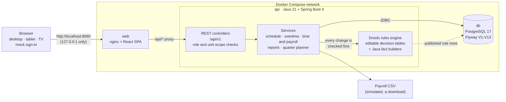

# ShiftCircle documentation

ShiftCircle is a shift-scheduling prototype for a fictional 24/7 correctional centre. It is built with a configurable rules engine, a whole-quarter planner, time and attendance, and a simulated payroll export.

All data is synthetic, and sign-in and payroll are simulated.

This page is plain Markdown with relative links. It reads on GitHub as it is. It also works on GitHub Pages with no build step, provided Pages serves the repository root, because some links point up to files beside `docs/`. The site then starts at `/docs/`.

## Architecture at a glance

Three containers on one Docker network. Only the web is published to the host, on `127.0.0.1`. Every change a person makes goes through the rules engine before it is saved.

How one change flows: the supervisor proposes an assignment → the API previews it through the rules engine → a **Block** refuses it (or asks for an emergency override with a written reason where the policy allows one), a **Warn** needs an acknowledgement, a **Pass** saves → the change is written with an append-only audit event. Rule changes go through a second person (maker/checker) and are published without a code change. The detail is in [Architecture](03-architecture.md), [Rules engine](04-rules-engine.md) and [Deployment](08-deployment.md).

## Documentation map

Which document answers which question an assessor is likely to ask:

| If you want to know… | Read |
|---|---|
| How to run it, and what each setting does | [INSTALL.md](../INSTALL.md), then [Deployment](08-deployment.md) |
| What it does, screen by role | [User guide](../USER-GUIDE.md) and the five role pages in [user-guide/](user-guide/) |
| A five-minute tour of the main flows | [Demo script](demo-script.md) |
| What problem it solves, and what was left out | [Scope and plan](01-scope-and-plan.md); what is deliberately **not built** is in [Testing §8](10-testing.md#8-intentionally-not-built) |
| What each requirement is, and which test proves it | [Requirements](02-requirements.md) → [Traceability](traceability.md) (requirement → code → test) |
| How the rules work, and where the numbers come from | [Rules engine](04-rules-engine.md), [Union rules](05-union-rules.md) (many values are marked MOCK) |
| How the system is built and why | [Architecture](03-architecture.md), [Data model](06-data-model.md), [API](07-api-spec.md), [Decisions](decisions.md) |
| Who may do what, and how it is enforced | [Access control](09-access-control.md) |
| How it was tested, and the current test counts | [Testing](10-testing.md) ("Current counts"), [e2e/COVERAGE.md](../e2e/COVERAGE.md) |
| How AI was used, and what was checked by whom | [Build record](../BUILD_RECORD.md), [AI development log](process/ai-dev-log.md), [review rounds](process/review-rounds.md) |
| What changed between releases | [Release notes](process/release-notes.md), [Progress](../PROGRESS.md) |
| What is real and what is simulated, and the known limits | [README](../README.md) ("What is real and what is simulated"), [Testing §8](10-testing.md#8-intentionally-not-built) |
| The visual design | [UI specification](ui/README.md) |

## Use it

- [Install and run](../INSTALL.md): Docker only. Covers start, reset, upgrade and remove.
- [User guide](../USER-GUIDE.md): sign-in, words used throughout, and what to do when something goes wrong. Then one page per role:
  - [Officer](user-guide/officer.md)
  - [Supervisor](user-guide/supervisor.md)
  - [Planner](user-guide/planner.md)
  - [Auditor](user-guide/auditor.md)
  - [Rules admin and approver](user-guide/admin.md)
- [Demo script](demo-script.md): a five-minute walk through the main flows.

## How it works

| Doc | What's in it |
|---|---|
| [Scope and plan](01-scope-and-plan.md) | Problem, users, outcomes, priorities, assumptions |
| [Requirements](02-requirements.md) | Screens, functional and non-functional requirements, rules catalogue |
| [Architecture](03-architecture.md) | Containers, layers, change flow, security |
| [Rules engine](04-rules-engine.md) | Drools decision tables an admin can edit, and the publish pipeline |
| [Union rules](05-union-rules.md) | The mock collective-agreement rule set, with sources |
| [Data model](06-data-model.md) | PostgreSQL tables, constraints, migrations and seed |
| [API](07-api-spec.md) | REST endpoints, the rule-check and override contract, errors |
| [Deployment](08-deployment.md) | Docker Compose topology, configuration, path to pilot |
| [Access control](09-access-control.md) | Roles, permission matrix, mock sign-in, privacy |
| [Testing](10-testing.md) | Test layers, rule boundary matrix, scenarios, end-to-end flows |
| [Traceability](traceability.md) | Each requirement mapped to the code and the test that proves it, with PARTIAL and NOT BUILT marked |
| [Decisions](decisions.md) | The decision log (ADRs) |
| [UI specification](ui/README.md) | Design tokens, components and every screen |

## How it was built

- [Build record](../BUILD_RECORD.md): the two-page summary.
- [Process records](process/):
  - [the brief](process/HANDOFF.md);
  - [AI-assisted development log](process/ai-dev-log.md);
  - [review and QA rounds](process/review-rounds.md);
  - [release notes](process/release-notes.md).

## Licence

[MIT](../LICENSE).
