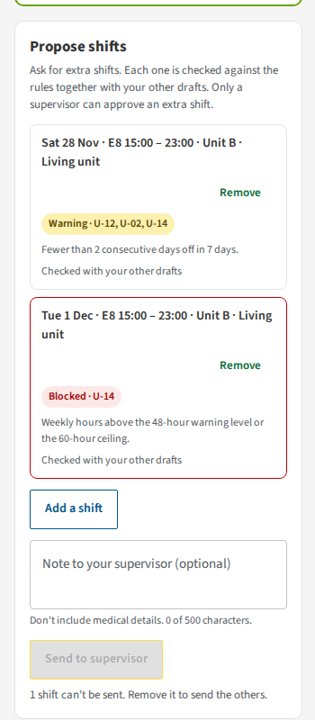
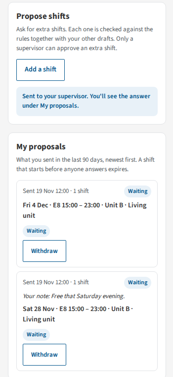

# Officer guide: My schedule

[← User guide](../../USER-GUIDE.md)

As an officer, you have one screen: **My schedule**.

<!-- No screenshot yet: desktop__employee__my-schedule (no clean capture from the gated build) -->
<!-- No screenshot yet: tablet__employee__my-schedule (no clean capture from the gated build) -->

## See your shifts

**My schedule** shows your calendar, with each rostered shift and its times. The key under it explains the marks:
- a rostered shift, with its times;
- a worked shift (the actual time was recorded);
- **Sick** and **Vacation**.

The calendar also shows offers by their state: waiting for reply, accepted, declined, confirmed.

At the top you see your **Next shift** (or "No shift scheduled") and your **Overtime this quarter**.

## Answer an overtime offer

When a supervisor offers you an extra shift, it appears under **Overtime offered to you**.

1. Read the shift: day, unit and times.
2. Choose **Accept** or **Decline**.

An accepted offer becomes your shift once the supervisor confirms it. When nothing is offered, the screen says "No overtime is offered to you right now."

## Tell the planner your preferences

The **My preferences** card has three choices:
- **Shift length** (8 h, 12 h or no preference; a 16 h day is a 12 h shift plus an extension, so 16 h is not offered, and a 16 h wish saved earlier shows as "16 h (no longer offered)");
- **Time of day** (pick any);
- the days you'd like off.

Press **Save preferences** to keep them. **Clear preferences** removes them, so the planner treats you as having no preference.

Good to know:
- Preferences are wishes, not guarantees. The planner meets them where staffing and the rules allow.
- Only 12-hour night crews work nights. If you work 8-hour shifts, a nights wish can't be met.
- If your unit uses 8-hour shifts only, the card says so.

<!-- No screenshot yet: desktop__employee__my-preferences (no clean capture from the gated build) -->

## Propose extra shifts

**Propose shifts** lets you ask your supervisor for extra shifts. Each shift is checked against the rules before you send it, together with the other shifts you are proposing, so two shifts too close together show it.

1. Press **Add a shift**. Pick the **date** (from tomorrow to 11 Apr 2027), the **unit** (your own unit is chosen first; you can pick any open unit) and the **shift**, then press **Add and check the rules**.
2. The shift appears as a draft with its answer:
   - **Passes**;
   - **Warning** with the rule codes (for example *Warning · U-12, U-14*) and the first reason. You can still send it; your supervisor sees the warning too;
   - **Blocked** with the rule codes and the reason. A blocked shift **can't be sent**;
   - **Can't be sent** with a reason that is not a rule (for example, the pay period is locked, or you already have that shift waiting).
   
   With two or more drafts, each says "Checked with your other drafts".
3. **Remove** takes a draft off the list. Your drafts stay if you refresh the page in the same tab; they are not sent until you press Send.
4. Optionally write a **note to your supervisor** (up to 500 characters). Don't include medical details.
5. Press **Send to supervisor**. The button is off while a draft is Blocked or still being checked, and the reason is shown next to it, for example "1 shift can't be sent. Remove it to send the others."

After sending, the card says "Sent to your supervisor. You'll see the answer under My proposals." and the drafts clear. At most 10 shifts go in one proposal, and at most 20 can wait for an answer at once.

## Follow your proposals

**My proposals**, under the Propose shifts card, lists what you sent in the last 90 days, newest first. Each proposal shows when you sent it, your note, and its state: **Waiting**, **Approved**, **Partly approved**, **Declined**, **Withdrawn** or **Expired**. Each shift in it has its own answer:
- **Approved by M. Ellis.** The shift is on your schedule.
- **Declined by M. Ellis: "Unit is fully staffed that night".** The supervisor's comment is shown as they wrote it.
- **Expired: the shift started before anyone answered.**

**Withdraw** a proposal while every shift in it is still waiting: press **Withdraw**, then **Withdraw proposal** to confirm. Once a supervisor has answered part of it, you can't withdraw the rest here; ask your supervisor instead.

Only a supervisor with that unit, or the planner, can approve an extra shift, and an approved shift counts toward your pay-period hours like an accepted overtime offer. *In this release the supervisors' proposals inbox screen is still being built (the API behind it is ready), so in the demo a sent proposal normally stays Waiting until you withdraw it or the shift starts.*

The old **/me/propose** link opens My schedule at the Propose shifts card. On a phone the cards stack, and the calendar scrolls sideways.

## What you can't do here

- See other officers' schedules.
- See the planner's draft plan. You see a quarter plan only once it is committed, as ordinary shifts. Changes the planner made by hand look the same as any other shift.
- Change a rostered shift yourself. Ask your supervisor.
