# Planner guide

[← User guide](../../USER-GUIDE.md)

You plan the whole quarter for every unit.

Your menu has these screens:
- **Quarter plan**
- **Preferences**
- **Units**
- **Planning board** (read-only for you)

You work in a **draft**. Nobody else sees it until you commit it.

## 1. Generate a draft

1. Open **Quarter plan**.
2. Optionally enter a seed (a whole number). The same seed always gives the same plan.
3. Optionally change the **Plan options** (below). The defaults make the same plan as before.
4. Press **Generate draft**. It takes a few seconds.

### Plan options

Three choices tailor how the plan is built. Each says in one sentence what it does and what it costs, and the scorecard shows its effect.

| Option | Choices | What it does |
|---|---|---|
| **Staff to include** | **Full-time officers** (always on) · **Part-time and casual officers** (on by default) | Untick part-time to see the plan the full-time crews make alone. Part-time officers are anyone below 1.0 FTE; in Datasets 120 and 150 that includes the casual relief pool. |
| **Part-time fill** | **Fill gaps only (as before)** · **Fill up to each officer's FTE** | As before, a part-time officer gets a shift only where their home unit is still short after the full-time crews. *Fill up to FTE* then also gives each part-time officer shifts above the minimum in their home unit where cover is thinnest, up to FTE × 80 h in each pay period, spread evenly through the period. It never takes a shift from a gap and every shift passes the same rule check, but it adds rule warnings (Warn, never Block). Part-time officers have no fixed pattern here, so these shifts can fall on any day the rules allow. |
| **Other units** | **Cover gaps from other units** (off by default) | After each unit's own officers (and closed-unit relief), every gap still open is offered to officers homed in another unit: part-time or full-time, not already working that day or on leave, with room under FTE × 80 h in that pay period (so a full-time officer only takes a shift in a short period, never into overtime), holding the qualification the gap's block asks for (first aid on the living units, Control, Escort), and a 12 h officer only where the unit allows 12 h. The lowest share of target planned goes first, then the newest officer. Every proposal passes the same rule check; a Block skips that officer. The roster marks such an officer **From** their home unit. It runs before *Fill up to FTE*, so gaps come first. |

Under the status line, **Made with:** says what the draft was made with, for example "Made with: full-time and part-time officers · part-time filled up to FTE · gaps covered from other units". **Generate again** opens with the last draft's options already filled in, and after the replace a **Compared with the previous draft** line gives every figure before and after: gaps, rule warnings, unused part-time hours, shifts and gaps covered from other units. With *Cover gaps from other units* on, a line under the tiles says how many gaps were covered from other units, by how many shifts and officers.

What the options did on the demo data (seed 20261001, measured on 24 Nov 2026; the Dataset 150 rows are pinned in `PlannerOptionsApiTest`):

| Dataset | Options | Gaps | Rule warnings | Unused part-time capacity | Shifts | Gaps covered from other units |
|---|---|---|---|---|---|---|
| 120 | defaults | 38 | 7 | 5,472 h | 5,103 | n/a |
| 120 | fill up to FTE | 38 | 17 | 260 h | 5,667 | n/a |
| 120 | other units | 38 | 7 | 5,472 h | 5,103 | 0 |
| 120 | fill up to FTE + other units | 38 | 17 | 260 h | 5,667 | 0 |
| 120 | full-time only | 156 | 6 | 6,720 h | 4,954 | n/a |
| 120 | full-time only + other units | 152 | 6 | 6,720 h | 4,958 | 4 |
| 150 | defaults | 100 | 39 | 3,515 h | 5,414 | n/a |
| 150 | fill up to FTE | 100 | 51 | 496 h | 5,746 | n/a |
| 150 | other units | 72 | 59 | 3,337 h | 5,455 | 28 (41 shifts, 26 officers) |
| 150 | fill up to FTE + other units | 72 | 71 | 496 h | 5,769 | 28 (41 shifts, 26 officers) |
| 150 | full-time only | 687 | 5 | 10,080 h | 4,691 | n/a |
| 150 | full-time only + other units | 529 | 115 | 10,080 h | 4,894 | 158 (203 shifts, 82 officers) |

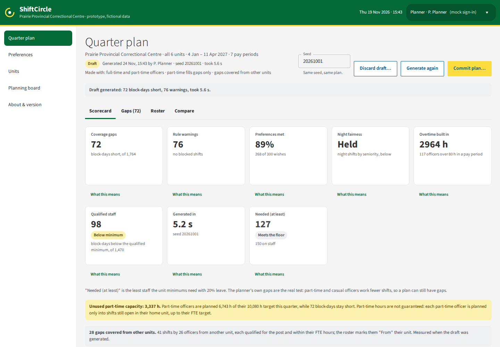

**What stays short, and why.** *Fill up to FTE* alone closes no gap: it only adds shifts where the minimum is already met. *Cover gaps from other units* is what closes gaps, and the scorecard keeps the reason for each gap it could not cover:
- **Dataset 120 (38 short, none covered):** all 38 are Escort & transport evenings. Escort needs every officer on duty to hold Escort, and no free officer in another unit holds it, so all 38 are *not qualified*.
- **Dataset 150 (72 short after 28 covered):** 46 *not qualified* (Control and Escort need every officer qualified; Control evenings and nights and Escort evenings are most of them), 14 *no hours left* (every qualified free officer is at FTE × 80 h for the pay period) and 12 *rule block* (a qualified officer with hours left was blocked, mostly by rest rules). By unit and block: Control evening 14, Escort evening 16, Unit B evening 11, Control night 8, and small numbers elsewhere.

Closing the rest needs more qualified officers (Escort and Control endorsements), not a different fill order. The extra shifts from other units add rule warnings (150: 39 to 59 for 41 shifts; all Warn), because they often land next to the officer's own rotation. Dataset 100 has no part-time officers; the first two options change nothing there.

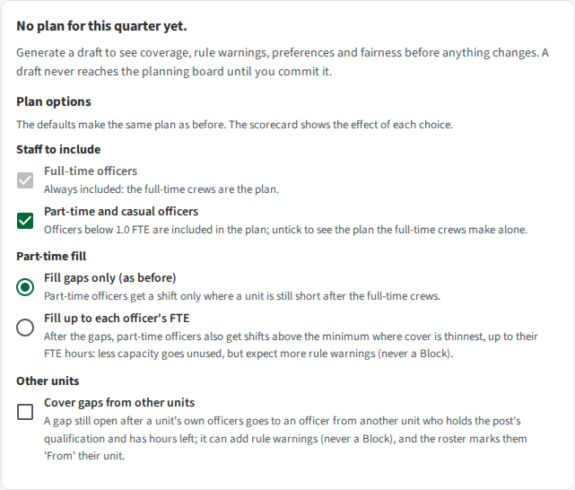

The draft opens with four tabs: **Scorecard**, **Gaps (n)**, **Roster** and **Compare**.

A note on the draft reminds you that it isn't on the planning board yet. Officers and supervisors can't see it until it's committed.

<!-- No screenshot yet: desktop__planner__planner__no-draft (no clean capture from the gated build) -->

## 2. Read the scorecard

The tiles sum up the draft. **What this means** under each tile explains it in a sentence or two.

| Tile | What it tells you |
|---|---|
| **Coverage gaps** | Block-days short of the unit minimum, out of all block-days |
| **Rule warnings** | Shifts that pass the rules but carry a warning; no draft shift is ever blocked |
| **Preferences met** | Share of officers' wishes met |
| **Night fairness** | Whether night shifts go to newer officers first (or to those who asked) |
| **Overtime built in** | Overtime hours the roster needs, and how many officers go over the pay-period threshold |
| **Generated in** | How long the draft took, and its seed |
| **Needed (at least)** | The least staff the unit minimums need, after leave; "Short" or "Meets the floor" |
| **Qualified staff** | Block-days with fewer qualified officers on duty than the unit's minimum |

Below the tiles, these cards give the detail:
- **Hours against target by FTE band**
- **Qualified staff by unit**
- **Night shifts by seniority**
- **Preferences by kind**
- **Staffing by unit**

Two of them need a note:
- **Qualified staff:** this is a warning only. The planner does not enforce qualifications. Qualification start dates are not checked: an officer with a qualification counts as qualified for the whole quarter.
- **Needed (at least):** a floor. Part-time and casual officers work fewer shifts, so a plan can still have gaps when the floor is met. The draft's own gaps are the real test.

Under the tiles, a yellow **Unused part-time capacity** line says how many part-time hours the plan leaves unused, for example "Unused part-time capacity: 5,472 h. Part-time officers are planned 1,248 h of their 6,720 h target this quarter, while 38 block-days stay short." Part-time hours are not guaranteed: with the default fill, a part-time officer is planned only into shifts still open in their home unit, up to their FTE target. The line ends by saying how the draft filled part-time officers; with **Fill up to each officer's FTE** it drops sharply (Dataset 150: 3,515 h to 496 h).

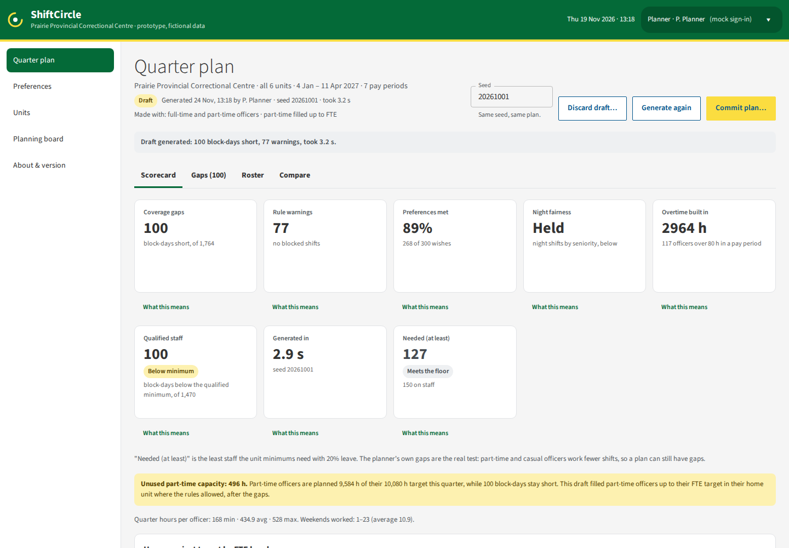

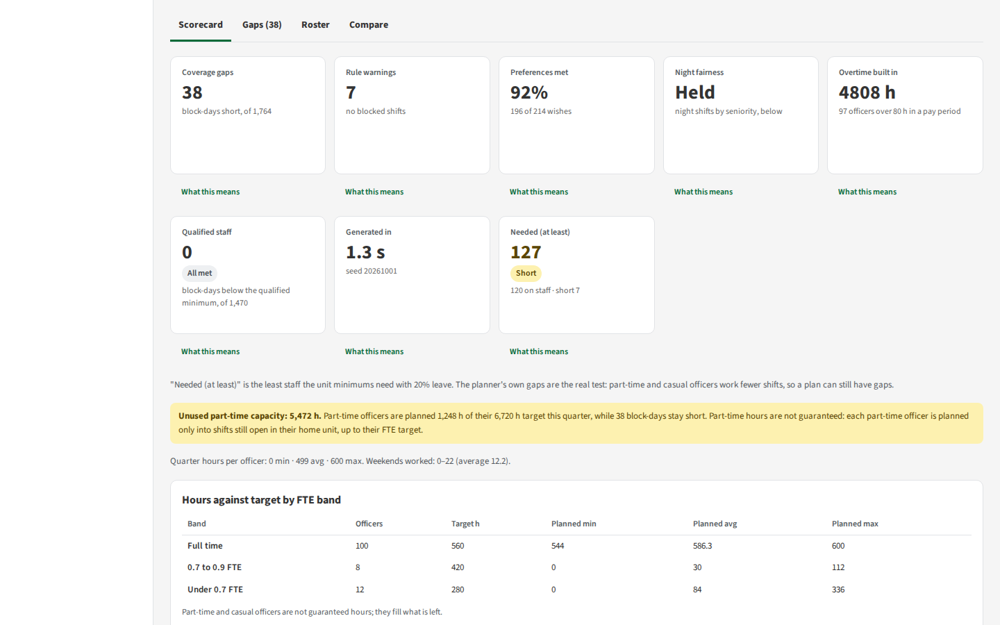

<!-- No screenshot yet: tablet__planner__scorecard (no clean capture from the gated build) -->

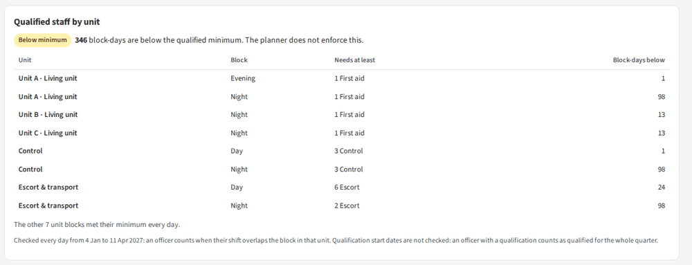

## 3. Gaps and warnings

**Gaps (n)** says how many block-days are short and shows them two ways.

- **Gaps by week and unit** is a strip with a row per unit and a column per week. Each cell counts that unit's short block-days that week, and a red number opens that week on the Roster tab.
- Below it, The runs table joins block-days that are the same unit and block on days in a row, for example "Escort & transport · Wed 13 – Sun 17 Jan · Evenings 15–23 · staffed 2–3 of 4 · short by 1–2". A line above says "38 short block-days in 7 runs". Narrow them with **Unit** and **Block**. **Show week** opens the first week of the run on the Roster tab.

The **Why** column says what happened. The usual answer is "No eligible officer was free without breaking a blocking rule. A supervisor fills it on the planning board."

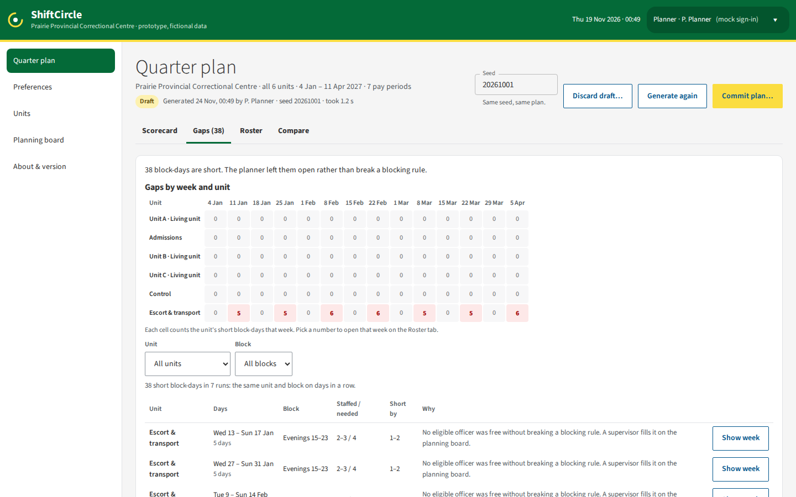

Some gaps can't be filled without breaking a rule, so the draft leaves them open rather than hiding them.

## 4. The draft roster

**Roster** shows one unit and one week of the draft.
- Choose the unit with **Unit**. Each option says how many gaps that unit has this week, and in the quarter.
- Jump to a week with **Go to week**: each of the 14 weeks says its number, its dates and how many gaps it has in all units (for example "Week 5 · 1 – 7 Feb 2027 · no gaps in all units"). **Previous week**, **Next week** and **First week** also work.
- **All units** shows the week's figures for every unit in one table. It starts closed: press **Show all units** to open it.
- A small **⚠** on a shift means a rule warning names it. Hover or focus it to read the warning, for example "Fewer than 2 days off in 7: Fewer than 2 consecutive days off in 7 days."
- Leave shows as **Vac**, **Sick** or **Other** instead of Off (section 8).
- An officer placed in this unit from another unit (by *Cover gaps from other units*, or as relief while their own unit is closed) has a **From Unit A** marker (their home unit) next to their name.

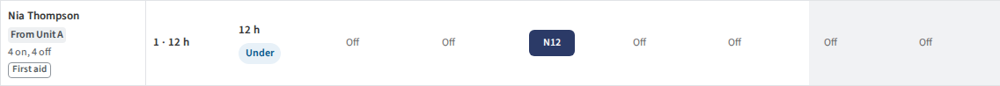

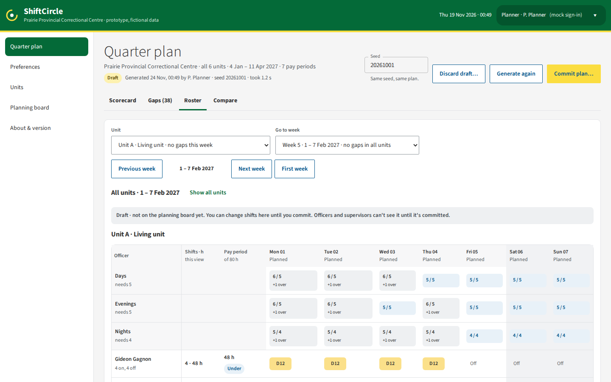

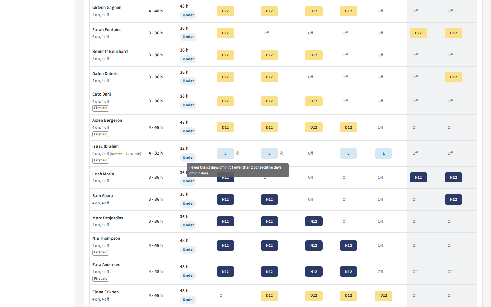

If a unit is closed from a date, a note says so. From that date the unit has no roster and needs no staff, and its officers appear as relief in other units.

## 5. Change shifts in the draft

You can change single shifts in a draft before you commit it. The planning board isn't touched. Every change is checked against the same rules a supervisor's change is.

**Tap a shift** on the draft roster, then choose one of:
- **Change time or unit…**: pick the date, shift and unit, then press **Check and save**.
- **Give to another officer…**: pick the officer, then press **Check and save**. This moves this one shift to them; it is not a two-way swap.
- **Remove from draft…**: the block may become a gap, and the scorecard will show it. No reason is needed.

**Tap an empty cell** to add a shift for that officer on that day. Choose the shift and unit, then press **Check and save**. You may add extra shifts.

After **Check and save**:
- **Pass:** the change is saved.
- **Warn:** nothing is saved yet. Read the warnings, then press **Keep the change with these warnings** if you want it. The shift then counts in **Rule warnings**.
- **Block:** nothing is saved. In a draft there is no emergency override. Choose another officer or time, or leave the gap.

After each save, the scorecard, gaps, warnings, Qualified staff and Staffing figures are worked out again for the whole draft. A shift you changed or added reads "· edited" on the roster, and the draft note counts your hand edits ("{n} hand edits so far").

If you see "The draft changed since you opened it" or "This draft was committed or discarded", reload and try again.

<!-- No screenshot yet: desktop__planner__draft-edit__dialog (no clean capture from the gated build) -->
<!-- No screenshot yet: tablet__planner__draft-edit__dialog (no clean capture from the gated build) -->

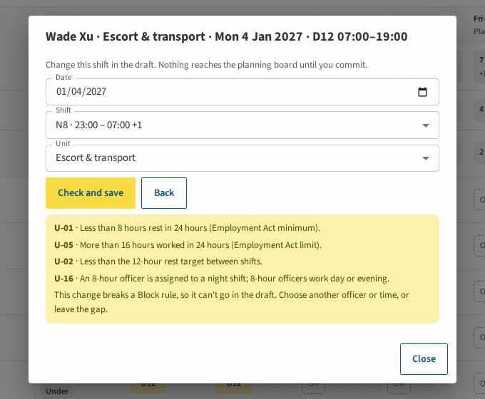

## 6. Compare

**Compare** puts the committed plan next to the board as it is now, so you can see what changed since the last commit.

## 7. Commit, generate again, or discard

- **Commit plan…** asks "Commit the quarter plan?". Then **Commit plan** writes the whole draft to the planning board, where supervisors and officers see it.
  - Commit checks every shift again, hand edits included.
  - If something changed since the draft was made, commit refuses with a reason ("Not committed: …"), and nothing is written.
- **Generate again** replaces the draft. The dialog shows the **Plan options** filled in from the current draft; change any, then press **Replace draft**. **Your hand edits are lost**; the confirm text says how many.

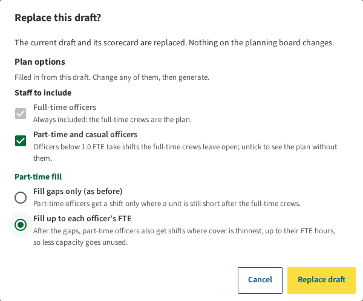
- **Discard draft…** then **Discard draft** removes the draft and its hand edits. Nothing on the planning board changes.

<!-- No screenshot yet: desktop__planner__regenerate-confirm__edits (no clean capture from the gated build) -->

## 8. Preferences

**Preferences** lists every officer's wishes by unit. **Not met only** narrows the list to the wishes the current plan misses.

**Add planned leave** records leave for one officer: pick the officer, the first and last day (inside the plan quarter, up to 31 days) and the type (Vacation, Sick or Other). Only the type is kept, never a reason. Each day is saved and audited as "Absence recorded". The draft roster shows those days as **Vac**, **Sick** or **Other** instead of Off. **Generate** again so the plan rosters someone else on those days. A day that already has another type of leave is not changed; the dialog lists it.

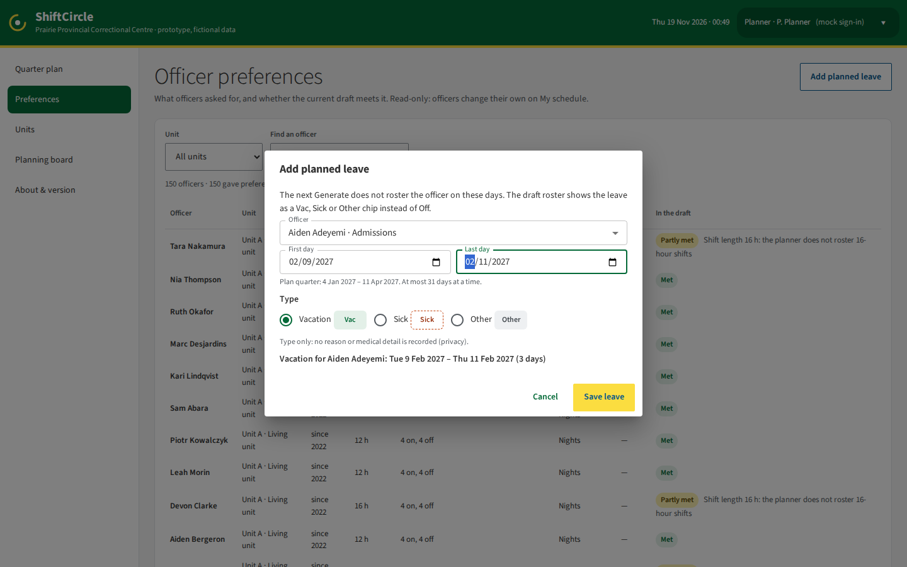

Dataset 150 already carries seeded leave (20% of each full-time officer's days), so its draft roster shows Vac and Sick chips from the start, and part-time officers fill the days the full-timers are away.

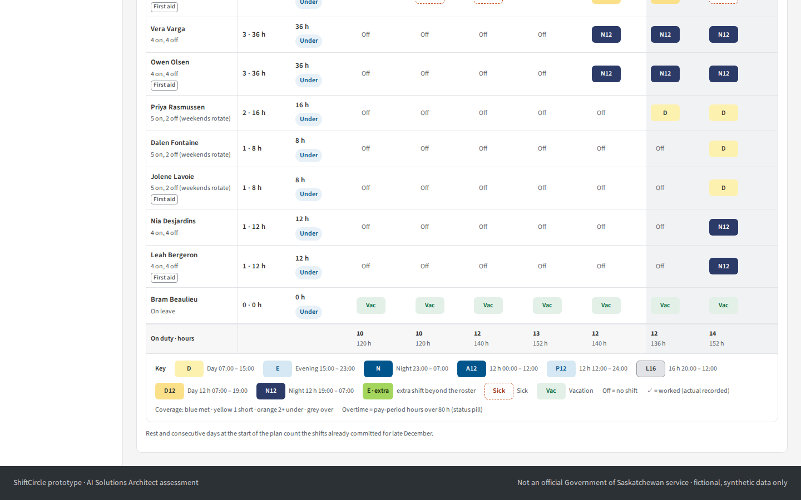

## 9. Units

**Units** shows each unit:
- whether it is open today;
- its closures;
- allocated headcount;
- officers on staff.

To close a unit:
1. Press **Close from a date…**.
2. Enter **Closed from**, optionally **Reopens on**, and a **Reason**.
3. Save.

The dialog tells you how many officers are homed there and how many published shifts are affected.

A closure that hasn't started offers **Change…** and **Remove…**. One that has started offers **Set reopening date…** or **Change reopening date…**.

**Edit** changes allocated headcount.

**Shifts in closed units** lists draft shifts that fall in a closed unit, with **Show on board**.

<!-- No screenshot yet: desktop__planner__units (no clean capture from the gated build) -->

## 10. Staffing by unit

The **Staffing by unit** card shows, for each unit and period:
- needed (at least);
- on staff;
- short.

**How** shows the formula. **Change…** sets the leave allowance used in the sums. A closed unit needs no one while it is closed.

## 11. Planning board

You can read every unit's live roster on the planning board, but not change it: "Read-only: the facility planner sees every unit's roster. Supervisors change their own." Reports are for supervisors and auditors, so your menu has no Reports item.

## 12. Reset the demo

In demo mode, **About & version** has **Reset the demo data**. Pick a dataset and start the reset.

It erases the synthetic roster, time entries, audit history and your draft (with its hand edits), then generates the dataset again.

## What you can't do here

- Change the live planning board. Supervisors change their own unit's roster.
- Change a plan after commit. From then on, supervisors change shifts on the board.
- Use an emergency override.
