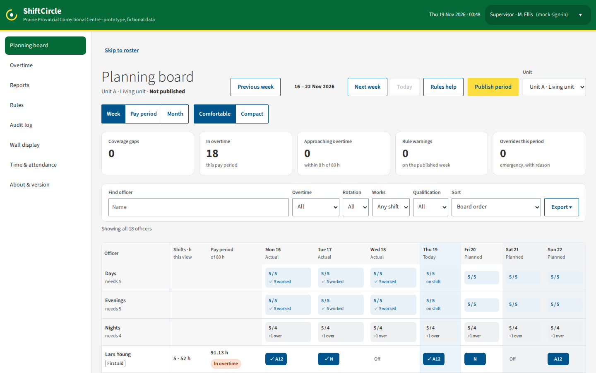
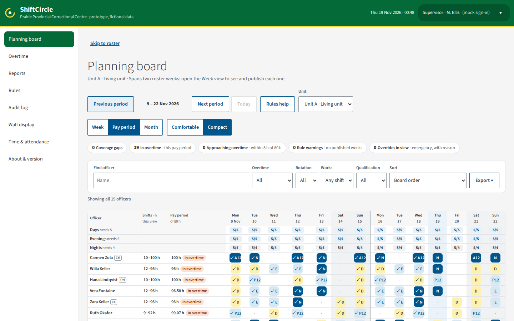
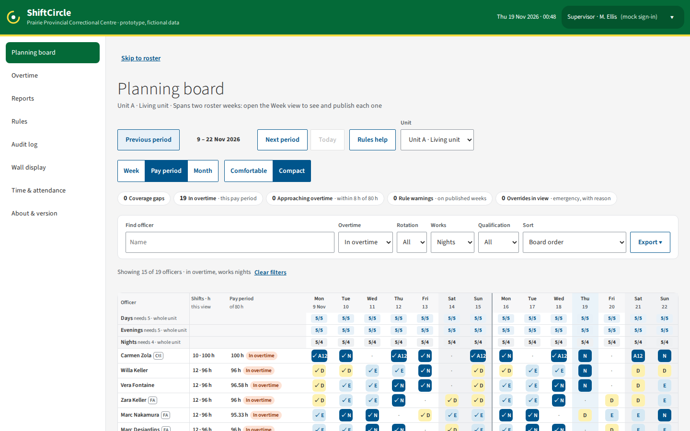
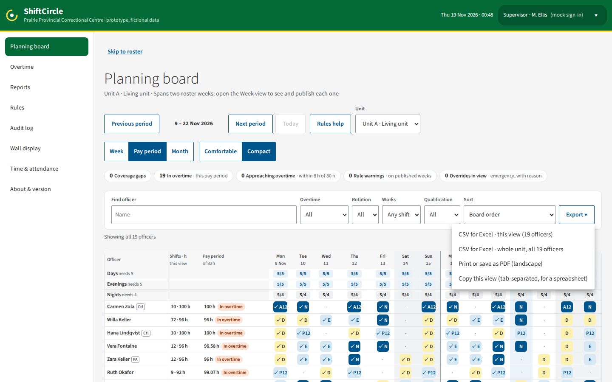
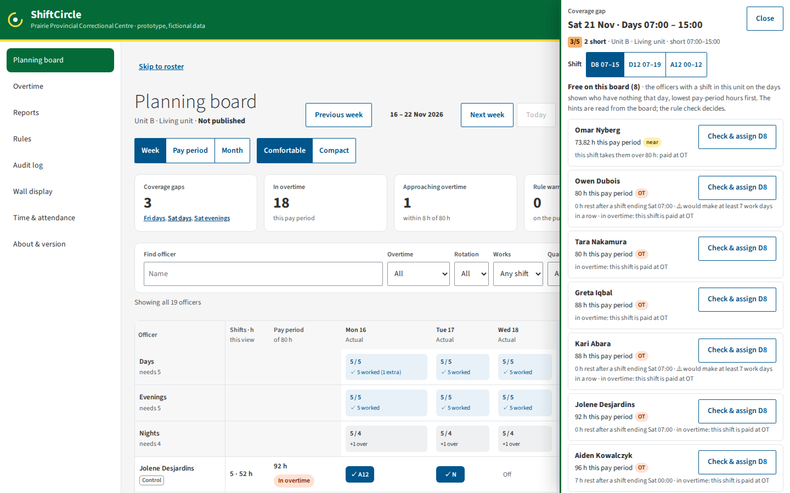

# Supervisor guide

[← User guide](../../USER-GUIDE.md)

You run your unit's roster week to week. Your menu has these screens:
- **Planning board**
- **Overtime**
- **Reports**
- **Rules**
- **Audit log**
- **Wall display**
- **Employee view** (only when your account is linked to an officer; the demo supervisors are not, so they don't see it)
- **Time & attendance**

## Planning board

The board shows one unit at a time:
- a row per officer, with their shifts, the hours in the view and their pay-period hours (and an **In overtime** or **Approaching** badge);
- three coverage rows (Days, Evenings, Nights) above the officers, each day showing on duty against the minimum, so a short block stands out;
- a small badge on an officer who holds a qualification (for example Escort or First aid).

To move around:
- **Previous** and **Next** (week, period or month) and **Today** step by the view (a week, a pay period or a month).
- **Unit** changes the unit.
- **Rules help** explains each rule in plain words.

### Week, Pay period or Month

The **View** buttons choose how much of the calendar you see. **Week** is the default.

- **Week** shows one roster week, Monday to Sunday, in the **Comfortable** density, with the five tiles above it (Coverage gaps, In overtime, Approaching overtime, Rule warnings and Overrides). This is the only view that shows **Not published** and **Publish period**.
- **Pay period** shows the 14 days that payroll uses (for example 9 – 22 Nov 2026) in the **Compact** density. The tiles become a row of figures, and each officer's row adds a total, with a total per day. Because a pay period spans two roster weeks, it says "Spans two roster weeks" instead of a publish state; open **Week** to publish one.
- **Month** shows the calendar month (1 – 30 Nov 2026), also compact. It says "Spans several roster periods".

**Comfortable** and **Compact** switch the density independently. The address keeps the view, the density, the unit and the date, so you can bookmark a board.

### Find, filter, sort and export

Above the grid, **Find officer** matches part of a name. The lists **Overtime** (All, In overtime, Approaching, Under), **Rotation** (All, 8 h, 12 h; Casual appears only when an officer's rotation is shown as casual), **Works** (Any shift, Days, Evenings, Nights) and **Qualification** narrow the officers, and **Sort** orders them (board order, pay-period hours lowest or highest first, name, or rotation). A line under the bar says how many officers you are looking at, for example "Showing 15 of 19 officers · in overtime, works nights", with **Clear filters**. The coverage rows always count the whole unit, whatever you filter, and say so.

**Export** has these choices:
- **CSV for Excel · this view**: the officers and days you are looking at;
- **CSV for Excel · whole unit**: every officer in the unit;
- **Print or save as PDF (landscape)**: for a week or a pay period (a month is too wide for one page); the printout keeps the footer line and says what was filtered;
- **Copy this view**: tab-separated, to paste into a spreadsheet.

### Fill a gap from the board

A coverage cell that is short, and the gap words in the **Coverage gaps** tile (for example "Sat days"), open a panel on the right: **Coverage gap**, with the day, the block and how many are short.

1. Pick the **Shift** if the block has more than one (for example D8, D12 or A12).
2. **Free on this board** lists the officers in the unit who have no shift that day, lowest pay-period hours first, each with a hint: hours this pay period, **near** or **OT** (this shift is paid as overtime), and any short rest or long run of days. The hints come from the board; the rule check decides.
3. Press **Check & assign** on an officer. This runs the same rule check as tapping that officer's empty cell: a Pass can be assigned, a Warn needs acknowledging, and a Block names its rules and cannot be assigned (or, for an emergency rule, overridden with a reason).
4. **Close** or Escape closes the panel. If nobody is free, the panel links to the **Overtime board** on that slot.

### Assign a shift

1. Tap an empty cell in an officer's row.
2. Pick the shift. ShiftCircle checks the rules at once:
   - **Pass:** confirm the assignment.
   - **Warn:** read the warnings, then acknowledge them to go ahead.
   - **Block:** nothing is saved. Choose another officer or shift, or use an emergency override if one is offered (below).

### Move or cancel a shift

Tap a shift on the board. The dialog says when it is scheduled, for example *Scheduled Tue 17 Nov 2026, 23:00 – 07:00 next day*.

- **Move…**: pick a **New date** and **Shift**, then press **Move shift**. The same rule check applies.
  - The line under **New date** says when the moved shift would start, in words. A date and shift that have already started are refused there, with the reason, before anything is sent: pick a later one.
- **Cancel shift…**: answer **Why is this shift cancelled?** in at least 10 characters, then press **Cancel shift**.
  - The shift stays in the audit trail.
  - If it was filling an open shift, that shift goes back to open.

**When the shift can't be moved or cancelled** (v1.2), the dialog says so as soon as it opens, and does not offer that action:

- **A shift that has started** (its start is at or before the demo clock, noon on Thu 19 Nov in the demo) has no **Move…** or **Cancel shift…**. The dialog says, for example, *This shift started on Tue 17 Nov at 23:00. Worked shifts are corrected in Time & attendance.* **Open in Time & attendance** opens that screen on the shift's pay period and unit, with the shift's record panel open.
- **Actual time or an absence recorded** on a future shift: no **Cancel shift…**. Correct the record in Time & attendance (the same button).
- **The shift fills an open shift**: no **Move…**. Cancel it and assign the open shift again instead.
- **The shift's pay period is locked**: no **Move…** or **Cancel shift…**, even if it has started. The dialog says *This pay period is locked. Unlock it with a reason to make changes.* (Unlock it on **Time & attendance** with **Unlock pay period**.)

The dialog knows what the board knew when it was loaded. If you leave the board open while a shift starts, reload it, or the server's refusal appears when you press **Move shift**.

The server still checks every move and cancel, including that the new start has not already passed. If it refuses one anyway (the shift changed since the board loaded, the pay period is locked, the shift was already cancelled), the dialog shows the refusal's title and what to do, for example *This shift changed since you read it · Reload the board and try again.*, with **Reload the board** where that helps.

<!-- No screenshot yet: desktop__supervisor__shift-actions (no clean capture from the gated build) -->

### Emergency override

Some Blocks allow an **Emergency override…**. The button only appears when every blocking rule allows it.

You must write the reason as a real sentence. It goes to the audit log, and the override shows in **Reports → Overrides**.

<!-- No screenshot yet: desktop__supervisor__override-dialog (no clean capture from the gated build) -->

### Publish a roster week

**Publish period** records your unit's roster for the period as published, and the board marks it so. Your name and the time are recorded. In this prototype publishing is a recorded state, not an access gate: My schedule does not yet filter by period status (docs/02 FR-06, partial).

Publishing is one-way in this prototype: a later correction is a further assignment, and the board marks it as unpublished.

A roster week is not a pay period: pay periods (two weeks) are locked on **Time & attendance**.

### Shifts from the quarter plan

When the planner commits a quarter plan, its shifts appear on your board as ordinary shifts.

- The planner may have changed some shifts by hand in the draft. They look the same on the board.
- A shift the planner kept with a warning arrives with that warning.
- The Audit log shows each hand change as "Draft shift edited".

## Overtime

The **Overtime board** lists open shifts, current needs first. Filled and past shifts stay below.

1. Pick an open shift to see **Eligible officers ranked**, by overtime this quarter and seniority, each with the **Rule check for this shift**.
2. Tick one or more eligible officers (**Select**), then press **Offer to selected (n)**. Each offer is recorded; email and text alerts are future work.
3. When an officer accepts, **Confirm** assigns the shift.

**Find eligible officer** on the planning board opens the overtime board on the open shift for that slot. If the slot has no open shift, the board says **No open shift for this slot yet** instead of showing another shift's list; **Back to the planning board** returns you to that week. No screen in this prototype creates an open shift yet (the API can, with `POST /api/v1/open-shifts`); assign another officer on the planning board instead.

Ordered (mandatory) overtime is only offered once the voluntary list is used up. It goes in reverse order, at most once per officer every 14 days.

<!-- No screenshot yet: desktop__supervisor__overtime (no clean capture from the gated build) -->

## Time & attendance

Record what actually happened on past shifts, then lock the pay period for payroll.

1. Pick a past shift in the grid. (From the planning board, **Open in Time & attendance** on a started shift opens it for you.)
2. Choose what happened, either:
   - **Worked as scheduled**;
   - **Adjusted times**;
   - an absence type, such as Sick or Vacation.

   Nothing is recorded until you choose. The pay codes are recalculated at once.
3. When the period is complete, press **Lock pay period**. The actuals become read-only and can be exported.

**Unlock pay period** needs a reason, which goes to the audit log.

<!-- No screenshot yet: desktop__supervisor__time (no clean capture from the gated build) -->
<!-- No screenshot yet: tablet__supervisor__time (no clean capture from the gated build) -->

## Reports

Reports has four tabs:
- **Coverage:** gaps by unit and block.
- **Hours:** scheduled against worked.
- **Overtime:** overtime hours per officer.
- **Overrides:** every emergency override, with its reason.

Each tab opens on its own default range, shown in **From** and **To**. To read another range or one of your units, set **From**, **To** and **Unit**, then **Apply**: every tab and every export use that choice until you press **Reset**. To must be on or after From, and at most 366 days after it.

**Export CSV** downloads the table. **Payroll export (CSV)** makes the simulated payroll file.

<!-- No screenshot yet: desktop__supervisor__reports-coverage (no clean capture from the gated build) -->

## Rules and Audit log

- **Rules** shows the published rules as tables and plain sentences. You can read them, not change them.
- **Audit log** lists every change: who did it, what they did, and when.
  - Filter with **Anyone**, **Any action** and **All entities**, then press **Apply**.
  - **Load more** shows older entries.

## Wall display

The unit office TV shows today at a glance:
- units short right now;
- open shifts today;
- on overtime this pay period;
- gaps tonight.

It is a shared screen, so it shows counts only, no names. **Leave the wall display** returns to your menu.

<!-- No screenshot yet: desktop__supervisor__wall-display (no clean capture from the gated build) -->
<!-- No screenshot yet: tablet__display__wall-display (no clean capture from the gated build) -->

## Employee view

Employee view opens **My schedule** for the officer record linked to your account, exactly as an officer sees it. It appears in your menu only when your account is linked to an officer; the demo supervisors (M. Ellis, J. Chen) are not, so they don't see it. Sign in as T. Nakamura to see an officer's view.

## What you can't do here

- See or change the planner's draft quarter plan. You see it only after it is committed.
- Change the rules. A rules admin drafts changes, and a rules approver publishes them.
