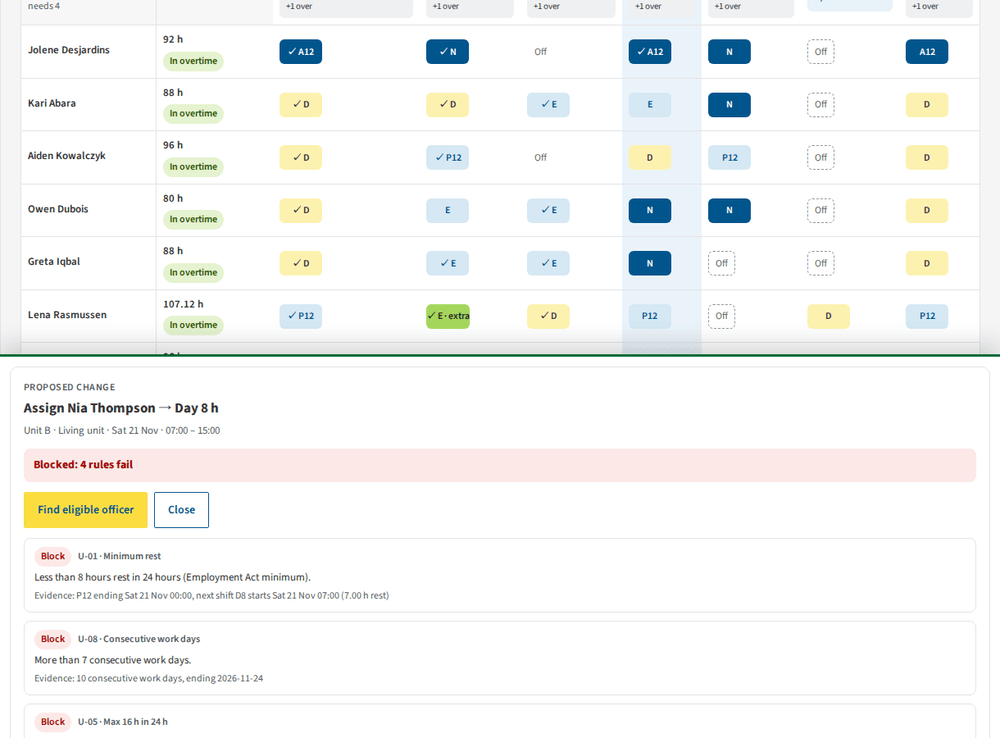

# Supervisor guide

[← User guide](../../USER-GUIDE.md)

You run your unit's roster week to week. Your menu has these screens:
- **Planning board**
- **Overtime**
- **Reports**
- **Rules**
- **Audit log**
- **Wall display**
- **Employee view**
- **Time & attendance**

## Planning board

The board shows one unit and one week:
- a row per officer;
- a coverage strip per block (Day, Evening, Night), showing whether the block meets its minimum.

To move around:
- **Previous week**, **Next week** and **Today** change the week.
- **Unit** changes the unit.
- **Rules help** explains each rule in plain words.

<!-- No screenshot yet: desktop__supervisor__planning-board (no clean capture from the gated build) -->
<!-- No screenshot yet: tablet__supervisor__planning-board (no clean capture from the gated build) -->

### Assign a shift

1. Tap an empty cell in an officer's row.
2. Pick the shift. ShiftCircle checks the rules at once:
   - **Pass:** confirm the assignment.
   - **Warn:** read the warnings, then acknowledge them to go ahead.
   - **Block:** nothing is saved. Choose another officer or shift, or use an emergency override if one is offered (below).

### Move or cancel a shift

Tap a shift on the board.

- **Move…**: pick a **New date** and **Shift**, then press **Move shift**. The same rule check applies.
- **Cancel shift…**: answer **Why is this shift cancelled?** in at least 10 characters, then press **Cancel shift**.
  - The shift stays in the audit trail.
  - If it was filling an open shift, that shift goes back to open.

<!-- No screenshot yet: desktop__supervisor__shift-actions (no clean capture from the gated build) -->

### Emergency override

Some Blocks allow an **Emergency override…**. The button only appears when every blocking rule allows it.

You must write the reason as a real sentence. It goes to the audit log, and the override shows in **Reports → Overrides**.

<!-- No screenshot yet: desktop__supervisor__override-dialog (no clean capture from the gated build) -->

### Publish a pay period

**Publish period** tells the officers in your unit that the roster is final. Your name and the time are recorded.

Publishing is one-way in this prototype: a later correction is a further assignment, and the board marks it as unpublished.

### Shifts from the quarter plan

When the planner commits a quarter plan, its shifts appear on your board as ordinary shifts.

- The planner may have changed some shifts by hand in the draft. They look the same on the board.
- A shift the planner kept with a warning arrives with that warning.
- The Audit log shows each hand change as "Draft shift edited".

## Overtime

The **Overtime board** lists open shifts, current needs first. Filled and past shifts stay below.

1. Pick an open shift to see **Eligible officers ranked**, by overtime this quarter and seniority, each with the **Rule check for this shift**.
2. Tick one or more eligible officers (**Select**), then press **Offer to selected (n)**. Each offer is recorded; email and text alerts are future work.
3. When an officer accepts, **Confirm** assigns the shift.

**Find eligible officer** on the planning board opens the overtime board on the open shift for that slot. If the slot has no open shift, the board says **No open shift for this slot yet** instead of showing another shift's list; **Back to the planning board** returns you to that week. No screen in this prototype creates an open shift yet (the API can, with `POST /api/v1/open-shifts`); assign another officer on the planning board instead.

Ordered (mandatory) overtime is only offered once the voluntary list is used up. It goes in reverse order, at most once per officer every 14 days.

<!-- No screenshot yet: desktop__supervisor__overtime (no clean capture from the gated build) -->

## Time & attendance

Record what actually happened on past shifts, then lock the pay period for payroll.

1. Pick a past shift in the grid.
2. Choose what happened, either:
   - **Worked as scheduled**;
   - **Adjusted times**;
   - an absence type, such as Sick or Vacation.

   Nothing is recorded until you choose. The pay codes are recalculated at once.
3. When the period is complete, press **Lock pay period**. The actuals become read-only and can be exported.

**Unlock pay period** needs a reason, which goes to the audit log.

<!-- No screenshot yet: desktop__supervisor__time (no clean capture from the gated build) -->
<!-- No screenshot yet: tablet__supervisor__time (no clean capture from the gated build) -->

## Reports

Reports has four tabs:
- **Coverage:** gaps by unit and block.
- **Hours:** scheduled against worked.
- **Overtime:** overtime hours per officer.
- **Overrides:** every emergency override, with its reason.

**Export CSV** downloads the table. **Payroll export (CSV)** makes the simulated payroll file.

<!-- No screenshot yet: desktop__supervisor__reports-coverage (no clean capture from the gated build) -->

## Rules and Audit log

- **Rules** shows the published rules as tables and plain sentences. You can read them, not change them.
- **Audit log** lists every change: who did it, what they did, and when.
  - Filter with **Anyone**, **Any action** and **All entities**, then press **Apply**.
  - **Load more** shows older entries.

## Wall display

The unit office TV shows today at a glance:
- units short right now;
- open shifts today;
- on overtime this pay period;
- gaps tonight.

It is a shared screen, so it shows counts only, no names. **Leave the wall display** returns to your menu.

<!-- No screenshot yet: desktop__supervisor__wall-display (no clean capture from the gated build) -->
<!-- No screenshot yet: tablet__display__wall-display (no clean capture from the gated build) -->

## Employee view

Employee view shows an officer's schedule exactly as they see it.

## What you can't do here

- See or change the planner's draft quarter plan. You see it only after it is committed.
- Change the rules. A rules admin drafts changes, and a rules approver publishes them.
